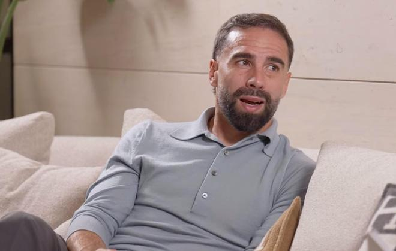

卡瓦哈尔接受了前马竞球员马里奥-苏亚雷斯的采访。谈话中，他回顾了自己在皇马的经历，谈到了无缘世界杯的遗憾、过去两年受到伤病困扰时的心情，以及离开皇马、加盟赫塔费的决定。

关于阿韦洛亚，你们以前是队友，你们之间的关系已经被问过无数次了，我就不再问了。但在最后那段时间，你是不是曾希望他能以不同的方式对待你？

最终做决定的是教练。就像我刚才谈到卡洛时说的，教练是球队的最高负责人，也是决定阵容的人。我一直尊重阿尔瓦罗的决定。他没有让我上场，我就继续努力，争取获得更多时间。

不过也有一件事，我当时在家里泳池旁边的门口弄伤了脚趾。孩子正好出来，我的脚被卡住，脚趾出现了骨裂。那是在最后三四周，我因此缺席了三四场比赛。但最后两场比赛我踢了。我记得有在塞维利亚的比赛，还有我告别的那一天。那两场比赛我感觉不错。

你就会想：“如果两个月前我能得到更多连续出场的机会，会发生什么？”我永远不会知道。

那就是我的一点遗憾：也许我的状态足以再留一年，也许不够。让我觉得可惜的是，没能连续踢上三四场比赛，真正看看自己的状态究竟如何。

你刚才提到了告别。现在回想起来，还是会激动吗？

那时候你情绪已经完全绷不住了吧？

是的。我当时都快说不出话了，我觉得自己已经很努力地忍住了。

不过我当时说得还好，但之后的几天，我在家里哭了很多次。

哪一条留言最让你感动，或者哪个时刻最特别？

最特别的时刻，是我看到孩子们在球场中央朝我跑过来。那一刻你会意识到自己在那里经历了多少成长：你来的时候还是个孩子，离开时已经成了一个家庭的父亲。还有那些看着你长大的人，大家都在为你鼓掌。那是一个非常令人感动的时刻。

你是怎么度过这个夏天的？收到了多少份报价？

说实话，收到了不少。但该怎么说呢？感谢上帝，当你没有经济方面的迫切需求时，你就可以自己做决定。我觉得这就是关键。

现在我非常看重孩子们生活的稳定性。每个人都了解自己的孩子，也会考虑他们能不能适应不同的地方。在这件事上，我现在有点胆小。年轻的时候，我一个人去哪里都没有问题。但现在有了家庭，虽然孩子们还小，我还是会担心。

孩子们适应得很好，他们是最容易适应的。

是，他们适应能力最好。但我也说不清，尤其是9月初开学之后，虽然那时转会市场已经关闭了，我看到他们和学校里的朋友们在一起那么开心，就会想：如果我们要离开，去的地方必须满足所有条件。要有好的学校，要安全，最好有直飞马德里的航班，气候也要好……有一系列条件，但并不是所有地方都能满足。

我听你说，你把家庭放在了优先位置。也就是说，如果你还是单身，现在可能已经在卡塔尔或者沙特了？

我不知道，真的不知道。而且还有战争的问题。我们身边的人也很近距离地经历过这些，何塞卢和萨拉维亚都是。萨拉维亚是我在足球圈里交到的最好的朋友，他就在卡塔尔。今年我们从他们那里近距离感受到了这些，所以也会有一点害怕。

但何塞卢去了那里，对吧？

对，他现在就在那里。那确实是一个选项。但就像我说的，最终出现了赫塔费这个选择。我觉得在夏天中段，我的想法突然发生了变化。之前我也考虑过美职联，虽然那不是主要的选择，还有你刚才说的卡塔尔、沙特等等。

但到了夏天中段，我又想起我们刚才说的：“如果我当时能够连续踢三四场比赛，会发生什么？”我意识到自己想继续参加高水平的竞争。

也就是说，虽然你没明说，但你潜意识里想的是：我要继续比赛，如果表现好，说不定还能回到西班牙队。

我不知道，我不知道。你真坏。我真的不知道。但还是那句话，当你的生活稳定时，你就能自己做决定。

后来我对妻子说：“我想继续竞争，想继续留在赛场上。”比起就这样退役，我更愿意在继续比赛、继续尝试的过程中结束职业生涯。这就是我内心真正想要的。

非常、非常重要。尤其是我的妻子，无论顺境还是逆境，她都一直陪着我、包容我。她受了这么多，已经给自己赢得进入天堂的资格了。我非常幸运，真的非常幸运。她全心全意地为我们这个家付出。如今，我妻子给两个孩子都喂了两年多、两年半的母乳，这并不常见。孩子们直到3岁才去学校，之前一直待在家里。在我们这个行业里，这样的情况并不常见，所以我非常珍惜她的付出。她是一位很棒的母亲。

而且当我们心情不好回到家时，妻子总是要承受很多……

对。我记得上周我告诉她：“我这里有一点不舒服，我要去让人检查一下。”最后没什么事，只是肌肉负荷有点大。她给我打电话问：“他们怎么说？”我说：“没事，只是肌肉负荷有点大。”

她说：“呼，还好。因为你受伤的时候，要照顾、忍受你，对我来说简直就是一场地狱。”

我说：“好吧，好吧，没事，一切都好。”

为什么最终选择了赫塔费？

你已经不想离开这里了。

没错。我已经在这里安定下来，孩子们也在这里上学。赫塔费当时更需要一名边路球员。不过现在我们可以踢五后卫，有安德烈斯-加西亚和基科-费梅尼亚这样的翼卫，基科以前也踢过边锋。

另外，无论是教练还是俱乐部的计划，都让我充满期待。我想重新参加比赛，重新在西班牙踢球。

还有你之前在采访中读到的，我一直都在赢球的球队踢球。这个想法并不是最近才有的，几年前我就想过：如果要背负那样的压力，为保级而战，会是什么感觉？但我很喜欢挑战，也喜欢经历新的事情。说实话，我在这里很开心，和大家相处得也很好。

希望你们不用为保级而战。

希望如此。希望我们能在4月份就完成目标，之后一切都顺顺利利。但现实是，我们的目标就是保级，所以我们必须为此努力。

特别声明：以上内容(如有图片或视频亦包括在内)为自媒体平台“网易号”用户上传并发布，本平台仅提供信息存储服务。

Notice: The content above (including the pictures and videos if any) is uploaded and posted by a user of NetEase Hao, which is a social media platform and only provides information storage services.

星河漫山野 2026-11-17 04:21:19

懂球帝 2026-11-17 05:30:06

懂球帝 2026-11-17 05:19:23

懂球帝 2026-11-17 05:19:23

足球印象CC 2026-11-16 21:02:04

元气满分吖 2026-11-17 02:04:50

懂球帝 2026-11-16 23:50:14

足球印象CC 2026-11-14 09:11:03

足球印象CC 2026-11-15 08:56:57

孤酒老巷QA 2026-11-15 16:25:56

CR7足球频道 2026-11-14 17:35:37

海浪星体育 2026-11-16 11:09:26

咪咕体育 2026-11-14 12:21:09

张硜卤说体育 2026-11-15 14:26:21

精彩背后 2026-11-15 14:23:41

罗氏看球 2026-11-14 11:46:55

元气满分吖 2026-11-17 06:19:51

薛艳艳爱生活 2026-11-16 11:13:40

村里整活小分队 2026-11-15 01:30:58

精彩一网打尽 2026-11-16 15:29:28

懂球帝 2026-11-17 03:44:05

収起了底线 2026-11-17 01:58:47

一个香蕉说球 2026-11-15 14:04:49

骄阳之夏明 2026-11-17 01:10:01

左脚爆射得分 2026-11-16 11:15:56

球事百科吖 2026-11-17 06:16:39

一个香蕉说球 2026-11-15 14:06:01

薛艳艳爱生活 2026-11-14 11:20:35

懂球帝 2026-11-17 00:34:12

生活超有趣 2026-11-14 14:34:24

懂球帝 2026-11-17 05:52:18

张硜卤说体育 2026-11-17 00:28:24

零度眼看球 2026-11-17 06:40:13

薛艳艳爱生活 2026-11-14 11:40:38

米奇兔 2026-11-14 13:02:11

狍子歪解体坛 2026-11-15 11:13:29

小狐狸皮普的英语探险 2026-11-16 18:04:25

狍子歪解体坛 2026-11-16 07:19:18

罗克 2026-11-15 12:05:15

看看新闻Knews 2026-11-15 11:25:26

## 配图

图：综合（网易体育 · 2026-11-17）

## 来源

- [网易体育 · 原文](https://www.163.com/dy/article/LBTTF20A0549BAP0.html)
