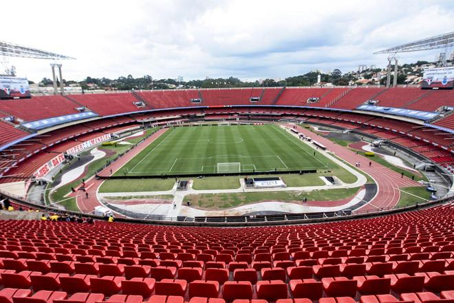

圣保罗正在与巴西布拉德斯科银行就莫隆比体育场的冠名权展开谈判。目前，俱乐部与亿滋国际签订的冠名权合同将于2027年1月31日到期。

据环球体育报道，相关谈判由圣保罗营销总监安德烈-马克斯负责。目前，双方对于冠名费用和体育场新名称的讨论仍处于初期阶段。

初步计划是签订一份为期三年的合同，与圣保罗此前和亿滋国际签订的协议期限相同。不过，圣保罗希望新合同能够拥有更长的期限，但目前在市场上寻找合适的合作方案并不容易。

圣保罗与布拉德斯科银行长期保持着良好的合作关系。该银行不仅在莫隆比体育场内设有分支机构，也是俱乐部员工的工资发放银行。

圣保罗高层邦雅曼-安德烈此前在接受环球体育采访时，并未排除与亿滋国际续约的可能性，但也承认俱乐部正在与其他品牌接触。

“我们并没有结束与亿滋国际的谈判。双方关系非常好，距离合同到期还有三个月，目前一切仍在讨论之中，合同也依然有效。我们会继续谈判，同时也会听取其他品牌的报价。当然，我们确实也在与其他品牌进行接触。”

除了布拉德斯科银行，圣保罗此前还曾与汽车制造商比亚迪进行谈判，但双方尚未取得实质性进展。

圣保罗目前与亿滋国际签订的合同总价值为7500万雷亚尔，期限三年，俱乐部每年可获得2500万雷亚尔的冠名权收入。

特别声明：以上内容(如有图片或视频亦包括在内)为自媒体平台“网易号”用户上传并发布，本平台仅提供信息存储服务。

Notice: The content above (including the pictures and videos if any) is uploaded and posted by a user of NetEase Hao, which is a social media platform and only provides information storage services.

暮年听风 2026-11-19 05:35:03

懂球帝 2026-11-19 00:30:49

懂球帝 2026-11-19 00:30:50

最佳菜鸟 2026-11-18 11:28:52

懂球帝 2026-11-19 05:37:06

懂球帝 2026-11-19 02:26:08

Shoot体育 2026-11-18 11:07:54

悠悠说世界 2026-11-19 00:40:15

懂球帝 2026-11-19 06:19:05

懂球帝 2026-11-19 06:19:05

懂球帝 2026-11-19 06:19:05

雪姐故事多 2026-11-17 07:46:00

爱笑西红柿 2026-11-17 16:54:52

极目新闻 2026-11-18 07:16:44

生活慢聊你我他 2026-11-17 08:59:20

参考消息 2026-11-18 12:42:06

人民网-人民日报 2026-11-18 05:42:09

阿野格斗解说 2026-11-18 10:36:51

轨道世界 2026-11-19 02:56:14

齐鲁壹点 2026-11-18 19:21:10

子弹财经 2026-11-19 03:33:27

鬼叔黍 2026-11-19 00:26:24

ChinaRain刘晓健 2026-11-17 06:43:44

每日经济新闻 2026-11-18 07:56:11

极目新闻 2026-11-18 10:22:19

虎嗅APP 2026-08-04 04:50:46

参考消息 2026-11-18 14:38:27

捡影 2026-11-18 13:37:50

上观新闻 2026-11-18 17:48:33

财联社 2026-11-18 20:31:34

嵩仔聊剧 2026-11-17 00:00:00

重庆城市TV 2026-11-17 14:11:46

眉眼动人 2026-11-18 00:41:05

新华社 2026-11-18 20:50:09

小婉说剧 2026-11-15 23:11:49

资阳发布 2026-11-17 16:12:13

环球网资讯 2026-11-19 06:08:08

新华社 2026-11-18 20:04:33

凤凰卫视 2026-11-18 10:46:39

进击的白小莹 2026-11-17 09:00:00

## 配图

图：综合（网易体育 · 2026-11-19）

## 来源

- [网易体育 · 原文](https://www.163.com/dy/article/LC3218HN0549BAP0.html)
