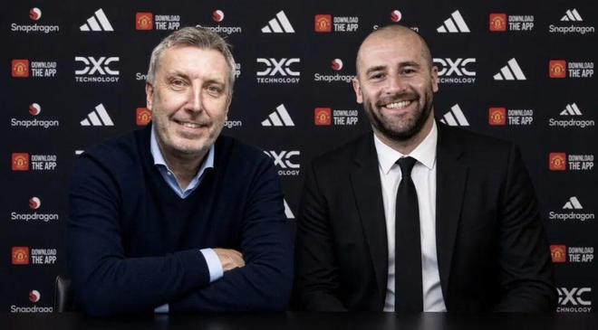

据英媒报道，毛里西奥·波切蒂诺推荐曼联聘请保罗·米切尔，接替杰森·威尔科克斯担任足球总监一职。早在波帅确定执教后不久，就有消息称其希望威尔考克斯离开，因为他要求引援工作由他信任的人负责。

波切蒂诺于上周五确定执教曼联，周三抵达卡林顿训练基地，正式接替了卡里克的帅位。

新帅亮相时，过去一周一直消失不见的威尔考克斯也回归了，与波帅一起拿着曼联球衣亮相。

球迷注意到海报中的一个细节：波切蒂诺自己拍照时笑容满面，但与威尔考克斯合照却没了笑容。许多人戏称，波切蒂诺也跟球迷一样嫌弃威尔考克斯。

这也许只是巧合，毕竟两人合影时，摄影师必定拍摄许多照片，其中有的在笑，有的没有，只是选择照片的关系而已。

但有英媒坚称，波切蒂诺与曼联老板格雷泽家族就更换威尔考克斯一事进行了会谈。后者是吉姆·拉特克里夫爵士的亲信，但被认为是导致俱乐部持续衰落的罪魁祸首之一。

「足球内幕」报道称，曼联考虑更换足球总监，据说这是波切蒂诺接受这份工作的关键原因之一。波切蒂诺推荐米切尔接替威尔考克斯的位置，这也是一个曼联球迷熟悉的人物。他与曼彻斯特也颇有渊源，其球员时代最早就在曼城青训，后转会维冈竞技。

早在2019年，在曼联决定增设体育总监一职时，米切尔就始终是传闻中的候选之一。尤其是朗尼克临时执教曼联时，曾在2022年2月‌邀请米切尔到老特拉福德，观看曼联的青年足总杯比赛。

只是，最终俱乐部选择了丹·阿什沃斯。后来阿什沃斯因为与老板意见不合被解雇，拉爵在2024年4月提拔威尔考克斯，威尔考克斯原本是技术总监。

波切蒂诺与米切尔有过两次合作，分别在南安普顿和托特纳姆热刺。两人在「圣徒」共事，米切尔还是球探，并为波切蒂诺推荐了维克托·万亚马、德扬·洛夫伦、萨迪奥·马内、肖恩·朗、杜桑·塔迪奇和弗雷泽·福斯特等名将，让该队一举脱离保级泥潭，跻身英超前八。

米切尔在热刺完成的第一笔转会引援，是以500万英镑的价格从米尔顿凯恩斯签下了德勒·阿里。之后，他相继为波切蒂诺签下孙兴慜、托比·阿尔德韦雷尔德、基朗·特里皮尔、穆萨·西索科和卢卡斯·莫拉等。

不过，到了2016年，米切尔因与俱乐部主席丹尼尔·列维不和，自己选择离开热刺。波切蒂诺承认，当时他感到很失望。波帅解释说：「我对他的决定感到非常失望，这是他个人的选择。你们知道，我和他在南安普顿就认识。我很失望，但那是他的抉择，我又能怎么办呢？我有没有试图劝说米切尔留下？很明显，我这么做了。然而，当他做出选择，有个人原因，除了尊重其决定，并继续工作之外，你别无他法。」

之后，米切尔的职业生涯并不顺利，他在莱比锡红牛和摩纳哥任职过。2024年7月至2025年6月期间，则担任纽卡斯尔联体育总监，替代被曼联挖走的阿什沃斯。

但是，因为和主帅埃迪·豪一直意见不合，米切尔再次离职后赋闲至今。至今，他仍未重返足坛，但这也意味着曼联如果要引进他，不需要支付任何补偿。

特别声明：以上内容(如有图片或视频亦包括在内)为自媒体平台“网易号”用户上传并发布，本平台仅提供信息存储服务。

Notice: The content above (including the pictures and videos if any) is uploaded and posted by a user of NetEase Hao, which is a social media platform and only provides information storage services.

MUREDS 2026-11-20 01:09:58

火星猪同学 2026-11-17 09:24:41

浣溪爱球 2026-11-17 12:02:31

球事百科吖 2026-11-20 06:05:03

浮云过影r 2026-11-19 04:31:52

海浪星体育 2026-11-17 11:55:54

火星猪同学 2026-11-19 18:42:21

快乐加载中21 2026-11-20 06:15:00

ChinaRain刘晓健 2026-11-19 16:00:38

晚风知我意21 2026-11-20 05:01:24

往日爱恨d 2026-11-19 05:35:07

足球印象CC 2026-11-17 18:59:18

各生欢喜者 2026-11-20 05:42:04

颜强 2026-11-17 18:04:04

AI小屋的日常随笔 2026-11-18 13:12:14

CR7足球频道 2026-11-17 12:25:53

球事百科吖 2026-11-20 06:06:18

赛场名场面 2026-11-20 05:15:54

懂球帝 2026-11-20 04:31:08

马三看世界 2026-11-19 00:03:01

Shoot体育 2026-11-18 11:07:54

罗吹终结者 2026-11-18 15:42:41

第X个想法 2026-11-18 11:55:45

香蕉皮儿 2026-11-18 11:30:46

山河藏意深 2026-11-19 16:36:22

足球印象CC 2026-11-16 11:33:14

张二要自律 2026-11-19 02:25:12

懂球帝 2026-11-20 06:07:09

球事百科吖 2026-11-20 06:07:36

一个香蕉说球 2026-11-17 23:17:55

风靡笑家 2026-11-19 14:11:41

懂球帝 2026-11-20 06:07:10

懂球帝 2026-11-20 05:36:06

为了更好 2026-11-19 04:01:59

左脚爆射得分 2026-11-17 17:55:46

奥力给趣笑堂 2026-11-18 10:49:39

慢享生活集 2026-11-20 03:18:01

我很乖 2026-11-19 04:44:35

悦悦知识分享 2026-11-20 04:35:26

也许友尽 2026-11-19 05:45:38

## 配图

图：综合（网易体育 · 2026-11-20）

## 来源

- [网易体育 · 原文](https://www.163.com/dy/article/LC5J5RIF0529999M.html)
