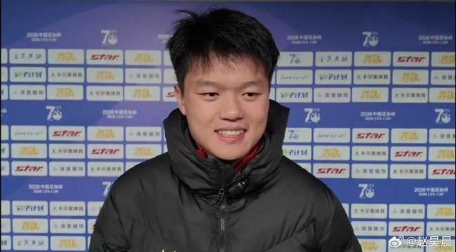

2026中国足协杯半决赛，上海海港客场2-0淘汰北京国安。上海海港俱乐部新闻官赵昊晨报道，赛后混采区，海港球员杨希接受了采访。

先简单说一下这场比赛结束后的感受。

杨希：感觉也不轻松。一开始对手压得很高，我们处理球不容易。对方罚下一人之后，我们变得轻松了些。

你的性格是不是一直都这么平稳？就算球队赢得了进入决赛的机会，我感觉你也没有特别表现出来……

杨希：又不是冠亚军决赛，没啥可以特别表现出来的。

这段时间挺疲劳吧？周二刚踢完国家队比赛，上周六你也踢了，感觉是不是挺辛苦的？

杨希：还行，反正还年轻，好好休息两天应该能恢复过来。

从国家队回来时，主教练有没有和你交流，关心你的身体情况？

杨希：我在国家队集训时，他会发消息关心我，问我身体怎么样、疲劳不疲劳。

赛前你觉得自己能踢满全场吗？体能方面有怎样的考虑？

杨希：一开始我想的是踢到哪算哪，也没想一定能踢到90分钟。

这应该是你（俱乐部）职业生涯第一次有机会争取冠军，有什么期待吗？

杨希：希望决赛能把握住机会吧。

会不会觉得这场决赛相对特殊一点？

杨希：不会，我年初也踢过U23亚洲杯决赛。

最后问一个轻松点的问题。比赛结束后在更衣室，谁表现得最欢快、最放松？大家都投蒋光太。他有哪些表现？刚才你观察到了什么？

杨希：具体我就不透露了，反正是蒋光太。

特别声明：以上内容(如有图片或视频亦包括在内)为自媒体平台“网易号”用户上传并发布，本平台仅提供信息存储服务。

Notice: The content above (including the pictures and videos if any) is uploaded and posted by a user of NetEase Hao, which is a social media platform and only provides information storage services.

足球人物往事 2026-11-18 17:14:33

球场新视角1号 2026-11-20 21:51:52

徐纗老表哥 2026-11-21 04:53:59

南海浪花 2026-11-21 05:32:49

落梅如雪乱飞 2026-11-21 05:07:38

蓝猫说剧 2026-11-21 03:27:12

天镜云生m 2026-11-18 07:22:43

文汇报 2026-11-21 04:04:10

一路荒凉如歌aa 2026-11-20 02:09:14

6个果子说球 2026-11-20 21:43:57

体坛扒客 2026-11-20 21:37:53

秋Tian动漫 2026-11-20 06:42:32

看尽人间百态 2026-11-21 04:51:40

刘笤说体坛 2026-11-21 05:46:55

残梦断忆 2026-11-21 01:21:22

残梦断忆 2026-11-21 01:22:42

懂球帝 2026-11-21 06:24:08

心也简单 2026-11-20 16:46:18

名都阳光 2026-11-21 02:47:27

实事球是 2026-11-20 18:53:16

80后体育大蜀黍 2026-11-20 23:45:48

超级无敌美少女何 2026-11-21 04:59:44

大锤RUNKMD 2026-11-20 05:47:46

极目新闻 2026-11-20 15:01:38

击你的心灵深处 2026-11-21 05:05:59

鱼肉肉pabo 2026-11-20 05:56:36

懂球帝 2026-11-21 06:34:43

星河漫山野 2026-11-21 06:27:46

浑元Rysn 2026-11-21 00:59:47

小朋友手工 2026-11-21 01:05:45

大象新闻 2026-11-20 18:35:02

搞怪趣星球 2026-11-18 10:58:24

树懒小结界 2026-11-20 04:43:27

左脚爆射得分 2026-11-18 11:56:36

翻车选手小李 2026-11-20 00:01:03

新民晚报 2026-11-20 18:54:38

潇湘晨报 2026-11-20 12:00:15

极目新闻 2026-11-20 15:01:38

财联社 2026-11-21 04:48:07

老付聊体育 2026-11-19 06:36:28

## 配图

图：综合（网易体育 · 2026-11-21）

## 来源

- [网易体育 · 原文](https://www.163.com/dy/article/LC873MHA0549BAP0.html)
