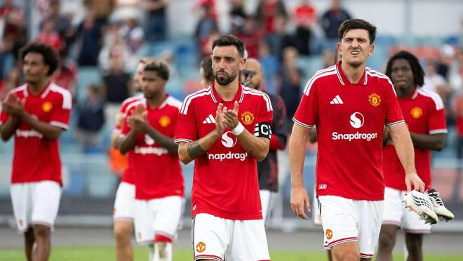

近期，关于曼联换帅的传闻满天飞，卡里克将会为球队本赛季的糟糕战绩买单。不过，这并不意味着球员就可以高枕无忧。英媒体《太阳报》披露，有多达10名曼联球员存在离队风险。

弗格森2013年退役，此后曼联一直在混沌之中徘徊。莫耶斯、范加尔、穆里尼奥、索尔斯克亚、卡里克、滕哈赫、阿莫林都无法让曼联彻底走上正轨。这赛季，曼联再创历史最差纪录，10轮仅1胜。

巨大的成绩压力之下，高层最终还是做出了放弃卡里克的决定。名记罗马诺表示，卡里克很快就会下课。然而，曼联的问题绝不只是撤下卡里克就能解决的，外界普遍认为曼联球员比教练更应该为糟糕成绩买单。

《太阳报》指出曼联似乎正准备对阵容进行大规模的重建，彻底推倒重来。可能离队的球员包括：长期受伤的卢卡-肖、频繁犯错的达洛特、老队长马奎尔、不定时炸弹利桑德罗-马丁内斯、状态不稳的德里赫特、伤病缠身的芒特、合同明夏到期的队长B费、克里斯滕、乌加特、拉什福德！

这10名球员的最终去留将由曼联董事会以及新帅来拍板。《太阳报》强调曼联的这次“整风”不只是针对教练席，大部分球员也会被波及。

同时，《太阳报》认为马兹拉维、门德斯、海文、约罗、梅努、库尼亚、姆伯莫等人都会留下。

特别声明：以上内容(如有图片或视频亦包括在内)为自媒体平台“网易号”用户上传并发布，本平台仅提供信息存储服务。

Notice: The content above (including the pictures and videos if any) is uploaded and posted by a user of NetEase Hao, which is a social media platform and only provides information storage services.

大眼睛看看 2026-11-10 02:50:33

懂球帝 2026-11-11 18:47:26

一个香蕉说球 2026-11-10 20:24:22

一个香蕉说球 2026-11-10 19:42:53

狍子歪解体坛 2026-11-09 02:58:01

狍子歪解体坛 2026-11-09 03:00:15

奥拜尔 2026-11-11 18:49:50

未来展望 2026-11-11 18:31:10

我爱英超 2026-11-11 16:50:25

懂球帝 2026-11-11 18:47:26

体育吐槽 2026-11-11 17:33:01

舌尖探店官 2026-11-09 04:30:42

精彩不容错过 2026-11-11 06:02:20

黄小仙的搞笑视频 2026-11-11 19:06:19

体坛周报 2026-11-11 18:46:13

足球印象CC 2026-11-08 20:59:59

足球印象CC 2026-11-09 08:08:01

原谅你 2026-11-10 05:02:38

白沙体育 2026-11-09 13:40:39

一个香蕉说球 2026-11-10 20:24:21

一个香蕉说球 2026-11-10 20:23:41

足篮大世界 2026-11-06 22:34:13

篮球人物故事会 2026-11-09 12:08:25

足球印象CC 2026-11-09 17:02:21

你是佛的弟子 2026-11-10 03:29:35

深情鱼摆摆 2026-11-10 14:18:45

风筝视频 2026-11-09 07:34:04

独特l 2026-11-09 10:27:31

众生的世界观 2026-11-09 02:53:45

陈赩爱体育 2026-11-09 02:02:26

群星纪元 2026-11-11 03:02:42

青树柠檬q 2026-11-11 09:18:30

白沙体育 2026-11-09 12:32:43

罗吹终结者 2026-11-11 18:38:28

新华社 2026-11-09 14:01:26

火星猪同学 2026-11-10 05:48:59

陈赩爱体育 2026-11-11 18:41:05

孤城落日 2026-11-10 16:56:01

薛艳艳爱生活 2026-11-09 12:52:54

左脚爆射得分 2026-11-10 11:14:26

## 配图

图：综合（网易体育 · 2026-11-11）

## 来源

- [网易体育 · 原文](https://www.163.com/dy/article/LBEJU3VR05566VBM.html)
