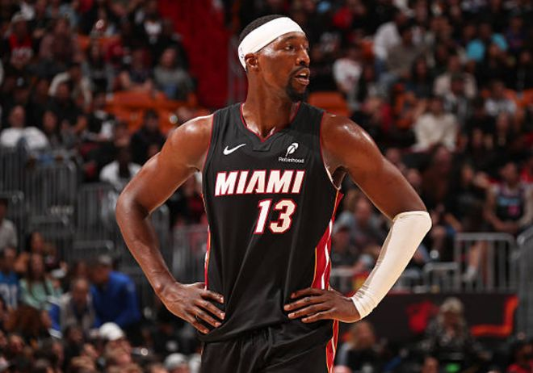

北京时间11月23日，NBA常规赛雷霆客场对阵热火，亚历山大与字母哥均缺席。阿德巴约贡献全能表现，激活热火团队攻势逐步压制雷霆，在末节开局扩大20+领先优势，最终热火123-113战胜雷霆豪取7连胜。

雷霆：斯特尔茨21分3板5助、麦凯恩20分2板3助、米切尔17分3板3助2断、迪克斯13分5板4助、肯里奇·威廉姆斯12分4板2助、克利福德11分3板2断。

热火：阿德巴约24分15板12助2断3帽、拉松21分3板5助3断、约维奇15分8板3助、米切尔14分4板3助、丰泰基奥11分、波蒂斯10分8板。

约维奇达成生涯200记三分里程碑。

阿德巴约本赛季首次贡献三双数据，也是生涯第9次贡献三双。

雷霆前16场10胜6负，热火前15场9胜6负。本场雷霆缺少亚历山大、霍姆格伦、卡鲁索、杰伦、马拉与华莱士等，热火缺少字母哥。首节开局，波蒂斯与克莱连中三分，热火率先取得11-2领先优势，雷霆一波8-2攻势追分。热火内外开花一波9-2攻势扩大22-12领先优势，雷霆连追4分，康韦尔上篮得分，阿德巴约与克莱继续率队扩大两位数领先优势，首节结束热火36-24领先雷霆。首节热火26中14，其中三分15中8，克莱9分与阿德巴约6+4+4；雷霆25中10，其中三分8中4，麦凯恩8分。

次节比赛，热火继续维持39-27领先优势，雷霆连追5分，丰泰基奥与斯特尔茨对攻一记三分。热火多点开花逐步维持55-42领先优势，雷霆冲击内线连追5分，阿德巴约内线肆虐引领一波8-0攻势扩大63-47领先优势。雷霆之后略有反扑追分，热火单节31-30净胜1分，上半场结束热火67-54领先雷霆。前两节比赛，雷霆三分18中9，麦凯恩13分引领3人得分上双；热火三分20中10，阿德巴约14+7+7与康韦尔10分。

中场休息回来，热火在两分半钟维持72-58领先优势，雷霆连追5分，热火连得4分。麦凯恩中投得分，热火一波6-0攻势扩大82-65领先优势，雷霆回敬一波8-2攻势追分，热火再得4分扩大15分优势。麦凯恩上篮得分，热火继续扩大领先优势，热火单节28-26净胜2分，三节结束热火95-80领先雷霆。前三节比赛，雷霆三分27中12，麦凯恩18分引领4人得分上双；热火三分28中12，阿德巴约20+12+8引领5人得分上双。

进入第四节比赛，热火率先连得5分扩大20分优势，雷霆一波9-3攻势缩小差距。热火回敬一波6-2攻势扩大18分优势。雷霆有所反扑追分，但热火持续保持两位数领先优势掌控局势，比赛已经提前失去胜负悬念，最终热火战胜雷霆豪取7连胜。

雷霆：皮维、肯威、麦凯恩、阿杰伊·米切尔、哈滕、

热火：克莱、波蒂斯、阿德巴约、拉松、戴维恩·米切尔

特别声明：以上内容(如有图片或视频亦包括在内)为自媒体平台“网易号”用户上传并发布，本平台仅提供信息存储服务。

Notice: The content above (including the pictures and videos if any) is uploaded and posted by a user of NetEase Hao, which is a social media platform and only provides information storage services.

扬子晚报 2026-11-22 20:36:44

看看新闻Knews 2026-11-23 12:06:24

扬子晚报 2026-11-22 20:21:58

中国经济网 2026-11-23 17:47:08

都市快报橙柿互动 2026-11-22 00:21:20

界面新闻 2026-11-23 15:41:07

财联社 2026-11-23 09:36:07

极目新闻 2026-11-23 11:35:40

新京报 2026-11-23 11:19:43

环球网资讯 2026-11-23 06:57:19

极目新闻 2026-11-23 12:29:01

界面新闻 2026-11-23 07:05:44

山西晚报 2026-11-23 10:35:33

证券时报 2026-11-23 12:36:03

财联社 2026-11-22 21:40:35

澎湃新闻 2026-11-22 22:29:05

极目新闻 2026-11-23 10:18:15

南方都市报 2026-11-22 21:46:03

大风新闻 2026-11-23 19:11:04

看看新闻Knews 2026-11-23 19:36:01

闪电新闻 2026-11-23 19:17:59

## 配图

图：综合（网易体育 · 2026-11-23）

## 来源

- [网易体育 · 原文](https://www.163.com/dy/article/LCDKCENT0529RKNN.html)
