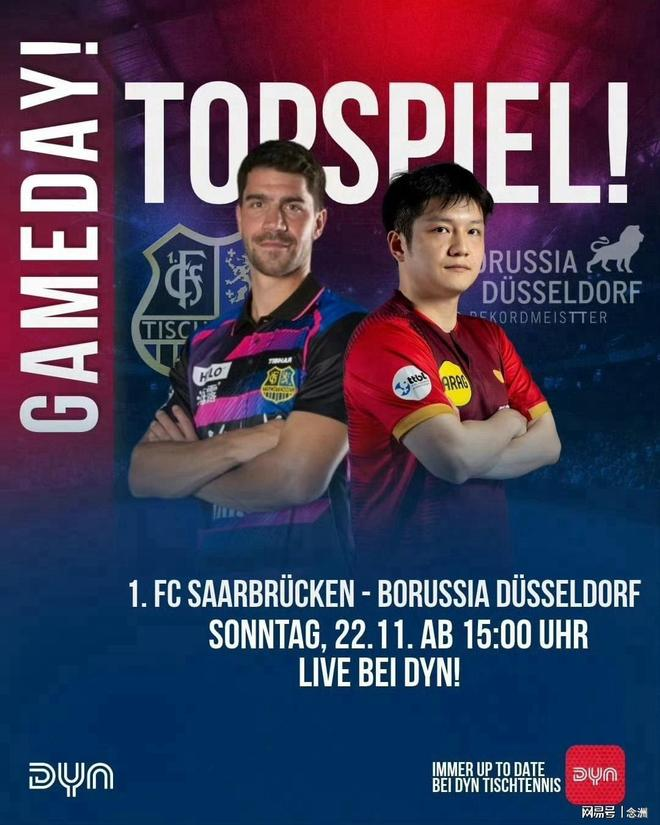

2026-2027赛季德甲乒乓球联赛第9轮，杜塞尔多夫3-1萨尔布吕肯，实现九连胜！樊振东对阵老东家第二盘输球，但是第四盘3-0横扫弗朗西斯卡，锁定胜局！

首盘，安东·卡尔伯格苦战五局，以3‑2击败弗朗西斯卡，为杜塞尔多夫拿下开门红。第二盘焦点战，樊振东迎战罗马尼亚选手约内斯库。开局阶段樊振东进入状态偏慢，场上无谓失误偏多，接发球节奏没有调整到位，对手出手果断、相持稳定，11-9、11-8连续拿下前两局，大比分0‑2落后。

第三局，樊振东逐步适应对手球路，上手质量提升，稳住相持节奏，以11‑8扳回一局，把比赛悬念保留下来。第四局双方比分咬得很紧，樊振东一度追到8平；关键时刻约内斯库敢于主动搏杀，连拿3分拿下本局，最终3‑1取胜。这也是樊振东本赛季德甲赛场单打首败。

第三盘，卡纳克3-2险胜罗布勒斯，第四盘樊振东再次出战，对阵老队长弗朗西斯卡。第一局，樊振东早早取得8‑4领先，但弗朗西斯卡顽强追分扳平，双方多次拉锯、多个局点来回争夺，樊振东稳住心态14‑12惊险拿下。

第二、三局，樊振东完全掌控比赛节奏，发球旋转、落点控制精准，正反手衔接流畅，减少了无谓失误，没有给弗朗西斯卡制造反扑机会，连续以11‑7拿下两局，直落三局零封对手，帮助杜塞尔多夫锁定全场胜利，完成自我救赎。

纵观全场，虽然樊振东输掉一盘单打，但迅速完成自我调整，在决胜盘顶住压力完成救赎，展现顶尖选手强大的抗压能力。

约内斯库虽然取胜，但赛后表示：“我从小就很崇拜樊振东选手，而且去年我还有机会和他在同一支队伍并肩作战，从那之后我更加敬佩他的为人。我很开心自己做到了这一切，但这并不会改变一个事实，他是史上最伟大的选手之一，同时也是现任奥运冠军。我会坦然看待这一切，今天好好享受这一刻，然后继续投入训练。”

特别声明：以上内容(如有图片或视频亦包括在内)为自媒体平台“网易号”用户上传并发布，本平台仅提供信息存储服务。

Notice: The content above (including the pictures and videos if any) is uploaded and posted by a user of NetEase Hao, which is a social media platform and only provides information storage services.

带你逛体坛 2026-11-23 12:31:08

八度科普 2026-11-23 10:24:27

眼界看世界 2026-11-23 16:30:23

娱乐事件不停更 2026-11-23 02:50:04

极目新闻 2026-11-23 10:18:15

冷眼看尽世间繁华 2026-11-23 17:23:31

梦醉为红颜一笑 2026-11-23 18:16:27

十夏九漓 2026-11-23 16:35:25

肆无忌惮的哭 2026-11-23 06:30:09

隐龙天下o 2026-11-23 06:18:36

孤城落日 2026-11-19 01:38:54

罐头告诉猫迷 2026-11-21 03:38:58

九分看世界 2026-11-23 12:12:59

老涺学科普 2026-11-23 04:24:21

老涺学科普 2026-11-23 04:21:50

老涺学科普 2026-11-23 08:55:41

青田花姑娘 2026-11-23 03:38:04

段得志 2026-11-23 17:42:53

跨越式 2026-11-23 11:36:08

老涺学科普 2026-11-22 21:48:14

通哥说事 2026-11-23 00:28:24

一往情深a 2026-11-23 00:54:15

勿忘心安j 2026-11-22 01:58:45

聚焦事件 2026-11-23 16:18:55

林尽处听雨眠o 2026-11-23 04:46:37

一叶禅林 2026-11-23 16:04:06

糖炒小栗子 2026-11-19 06:26:49

左脚爆射得分 2026-11-23 11:58:31

领略非凡 2026-11-22 02:56:31

斯帝卡V乒乓 2026-11-22 08:47:03

流云如水z 2026-11-23 05:27:21

漫小岛解说 2026-11-23 11:59:43

张硜卤说体育 2026-11-21 10:44:16

星视频 2026-11-23 17:44:35

咪咕体育 2026-11-21 16:22:59

Air空修 2026-11-21 12:53:29

阿缸追剧 2026-11-21 08:40:11

扬子晚报 2026-11-22 20:36:44

肚丝看生活 2026-11-21 09:02:20

小道爱娱乐 2026-11-21 11:35:03

## 配图

图：乒乓球（网易体育 · 2026-11-23）

## 来源

- [网易体育 · 原文](https://www.163.com/dy/article/LCDC1SG70553AOVQ.html)
