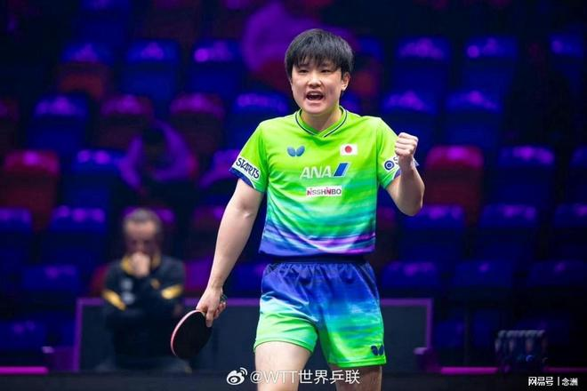

WTT法兰克福冠军赛男单1/16决赛，张本智和3-0战胜西多伦科，晋级16强。赛后，张本智和接受媒体采访。

三局比分分别是11-6，11-8，11-7，张本智和顺利赢下曾击败松岛辉空的西多伦科，他表示：“法国我一轮输，一点问题也没有，因为亚锦赛对我来说那场三连战是最需要的，拿到了以后能在那里休息了，够休息了。我觉得在蒙彼利埃站第一轮没发挥好，因为是在乌兹别克斯坦打得好。我觉得蒙彼利埃站那天发挥不好，证明了我在亚锦赛拼完了。我觉得很好，在法国休息好了。”

张本说道：“松岛的那个比赛看了，但还是右手左手有不一样。在我自己个人来说，在美国和他0-3，我就需要去看这一场。松岛那场我知道松岛输了，但是对我来说没有那么大的关系。我就从上一场、然后这几个月西多伦科的进步，去准备了以后，今天发挥得很好。”

谈到法兰克福冠军赛，张本智和罕见地没有提夺冠的话题，他说道：“已经第四年了吧，在法兰克福这个比赛馆打得已经很适应。然后德国这个国家也来很多次比赛，训练联赛打过，挺喜欢这个国家、在德国打比赛。”

特别声明：以上内容(如有图片或视频亦包括在内)为自媒体平台“网易号”用户上传并发布，本平台仅提供信息存储服务。

Notice: The content above (including the pictures and videos if any) is uploaded and posted by a user of NetEase Hao, which is a social media platform and only provides information storage services.

排球黄金眼 2026-11-04 04:08:37

人间闲散客 2026-11-02 00:28:52

搞笑的八爪鱼 2026-11-03 19:33:12

半夏余醉 2026-11-04 02:33:45

月影依风d 2026-10-31 18:19:55

徐竦解说 2026-11-03 14:33:57

正在输入幸福 2026-11-03 01:16:46

誮惜颜a 2026-11-04 06:05:28

大海体娱 2026-11-02 10:55:04

小陳同學 2026-11-04 00:10:44

第X个想法 2026-11-03 11:23:09

体坛扒客 2026-11-03 23:02:50

等风上青云 2026-11-01 12:00:50

显微镜下的人性 2026-11-02 03:14:35

风起天阑c 2026-11-02 00:10:47

家禽搞笑事务所 2026-11-04 02:19:31

大嘴说台球 2026-11-04 00:09:04

小兔子的快乐 2026-11-03 02:29:48

月影沙丘d 2026-11-03 06:59:37

芋泥哈波波 2026-11-02 01:55:11

笑衬孤独j 2026-11-03 12:54:34

咪咕体育 2026-11-02 13:52:38

宠物管理师雯雯 2026-11-01 08:31:38

知新使者 2026-11-03 01:49:04

人间闲散客 2026-11-02 01:11:31

南海浪花 2026-11-04 05:42:34

观象视频 2026-11-02 10:38:57

翻车选手小李 2026-11-03 00:55:22

薛艳艳爱生活 2026-11-03 11:18:11

娱乐佟掌柜 2026-11-03 21:08:31

杨哥乒乓 2026-11-01 22:26:01

蕾爸退休日记 2026-11-03 17:15:14

国+社区 2026-11-02 08:59:17

猫meme团子 2026-11-03 04:52:30

林尽处听雨眠o 2026-11-04 01:22:14

佳客体育 2026-11-03 20:59:39

残梦断忆 2026-11-03 20:40:00

精彩一网打尽 2026-11-03 03:00:43

星视频 2026-11-02 12:09:59

封面新闻 2026-11-02 13:17:31

## 配图

图：乒乓球（网易体育 · 2026-11-04）

## 来源

- [网易体育 · 原文](https://www.163.com/dy/article/LASDGGUT0553AOVQ.html)
