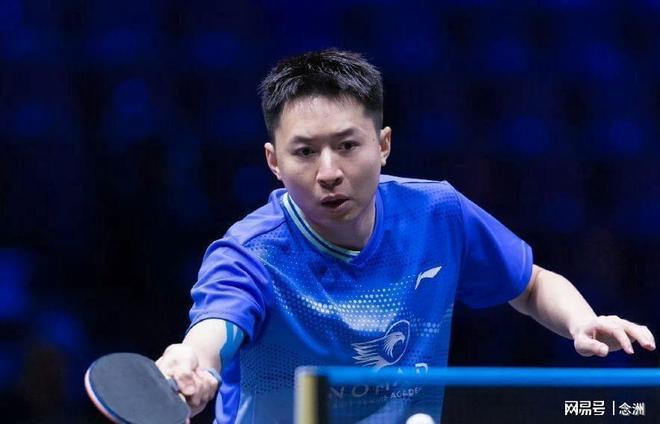

2026年WTT伊斯坦布尔常规挑战赛男单1/8决赛迎来重磅对决，前国乒世界冠军、现代表哈萨克斯坦出战的方博3-0横扫国乒新生代潜力小将陈俊菘。强势挺进男单八强。

本场对决堪称新老对决的经典较量。21岁的陈俊菘是国乒重点培养的左手生胶新星，打法灵动、进攻犀利，曾爆冷击败张本智和，备受球迷期待。而34岁的方博早已退出国乒，如今复出自费参赛，代表外协征战国际赛场。

首局比赛双方迅速进入状态，缠斗激烈、比分交替上升。陈俊菘敢打敢拼多次追分反超，局势十分胶着。关键9平节点，方博稳住心态，精准把控落点与旋转节奏，连拿两分11-9惊险拿下首局。

次局方博彻底掌控赛场节奏，迅速找到克制对手生胶打法的思路，高质量弧圈球持续压制对手。陈俊菘心态出现波动，频繁出现失误，难以组织有效反击。方博顺势拉开分差，以11-3速胜，将大比分扩大为2-0。

背水一战的陈俊菘在第三局放手一搏，开局打出5-0的强势领先，占据绝对优势。即便局势被动，方博依旧沉着冷静，不慌不忙追分纠错，一点点缩小分差。面对小将的反扑，方博顶住压力稳住关键分，多次追平比分，最终再度以11-9绝杀本局，零封拿下整场胜利。

赢球之后，方博挥拳怒吼，丝毫不给国乒队员面子。这场失利让陈俊菘止步16强，也让本站国乒男单仅剩削球手李天阳一根独苗，冲冠压力骤增。

特别声明：以上内容(如有图片或视频亦包括在内)为自媒体平台“网易号”用户上传并发布，本平台仅提供信息存储服务。

Notice: The content above (including the pictures and videos if any) is uploaded and posted by a user of NetEase Hao, which is a social media platform and only provides information storage services.

斯帝卡V乒乓 2026-11-12 11:02:31

匠心体育 2026-11-11 21:42:55

远方的青木 2026-11-13 16:03:03

时光礼记p 2026-11-13 04:02:57

狂破武神 2026-11-13 07:43:41

九分看世界 2026-11-11 11:39:23

小熊回收站 2026-11-12 03:29:44

老莫浅谈 2026-11-12 22:18:56

极度说球 2026-11-12 21:59:58

笑饮孤鸿非 2026-11-12 01:30:41

阿昙你好 2026-11-13 00:21:55

老贃是个手艺人 2026-11-14 02:19:59

远梦归晓r 2026-11-11 13:13:31

麦芽看世界 2026-11-10 02:01:09

半口仙气 2026-11-13 03:04:59

丁铗惊悚影视解说 2026-11-12 08:48:47

华夏云海 2026-11-10 17:27:12

天涯沦落人 2026-11-13 21:33:38

众生的世界观 2026-11-12 03:12:20

丁铗惊悚影视解说 2026-11-12 08:50:10

野火动漫 2026-11-12 14:12:28

麦芽看世界 2026-11-14 00:57:19

竞技追梦人 2026-11-12 00:00:00

趣笑小行星 2026-11-12 14:25:56

麦芽看世界 2026-11-13 00:54:09

纯白的梦j 2026-11-14 02:48:50

易说搞笑部 2026-11-12 12:27:16

麦芽看世界 2026-11-13 00:49:38

李喜林篮球绝杀 2026-11-13 22:28:32

麦芽看世界 2026-11-14 01:02:12

马克餐饮日记 2026-11-14 01:03:31

篮球过人技巧 2026-11-13 18:12:49

麦芽看世界 2026-11-14 00:58:55

麦芽看世界 2026-11-14 01:03:45

AI领航长 2026-11-13 21:55:41

麦芽看世界 2026-11-13 00:52:33

大财新鲜事 2026-11-14 01:01:24

星视频 2026-11-13 10:39:41

环球时报 2026-11-13 08:33:44

老糿尾声体育解说 2026-11-14 04:47:41

## 配图

图：乒乓球（网易体育 · 2026-11-14）

## 来源

- [网易体育 · 原文](https://www.163.com/dy/article/LBM5J7UO0553AOVQ.html)
