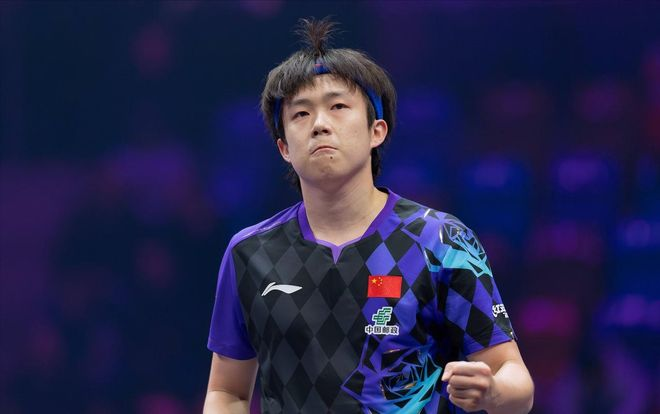

2026赛季WTT德国冠军赛于11月3日-8日在法兰克福举办。截至目前，比赛的首轮已经结束，男单方面的16强全部出炉：松岛辉空vs普卡、弗朗西斯卡vs杜达、吴晙诚vs户上隼辅、维姆vs雨果、林昀儒vs周启豪、温瑞博vs王楚钦、邱党vs奥恰洛夫、韩林vs张本智和。

11月6日凌晨，男单次轮的比赛正式打响，首场对决就是国乒两位球员的德比战斗，赛会4号种子王楚钦出战，对阵温瑞博，这场比赛的胜者将在第三轮和林昀儒vs周启豪的胜者交锋，竞争4强。

WTT德国冠军赛2026 | 男单1/8决赛

王楚钦0-3温瑞博【7-11/8-11/6-11】

1/4决赛对阵：温瑞博vs林昀儒or周启豪

G1王楚钦7-11温瑞博

开局之后，两人在前段和中段进行得非常胶着，从4-4到6-6。此时，王楚钦发球抢攻反超比分，但是随即出现进攻失误，7-7继续打平。末段温瑞博持续压制反手位得分，连拿4分先拔头筹，大比分1-0暂时领先。

G2 王楚钦8-11温瑞博

开局阶段，温瑞博正反手两面连续强势输出，无论是单面质量还是两面转换都非常稳定，3-1领先；接发球环节，王楚钦反手拧拉起板之后形成多拍相持，温瑞博反手暴拉斜线拉穿，王楚钦依靠正手对拉咬住比分，2-4。

王楚钦发球后正手起板抢攻斜线，温瑞博防回头擦边得分，随后连续防守王楚钦4板正手强攻之后转反攻得分，6-2拉开分差至4分；王楚钦接发球反手拧拉起板追分，落点方面压制温瑞博反手再追1分来到4-6；斗短环节，温瑞博反手果断起板拉斜线，接发球正手直接拉冲半出台，8-4分差重新回到4分。

王楚钦连续两板正手强攻追分，控短后正手起板拉斜线出界，5-9；温瑞博正手抢攻斜线被防擦边，随后反手拧拉接发球直接得分拿到4个局点，10-6。双方多拍相持，王楚钦被动中生智慧，反手侧切一板变节奏成功追分，温瑞博偷长球之后相持，反手回直线出界，10-8还有2个局点。

接发球环节，温瑞博反手拧拉直接起板得分，11-8拿下本局，大比分来到2-0暂时领先。

G3 王楚钦6-11温瑞博

开局温瑞博接发球冒高被抢攻，斗短之后反手起板草莓拧出完美弧线，1-1；王楚钦及时变化节奏，正手冲直线得分，但是反手起板擦网后回弹出界，2-2；温瑞博接发球反手拧拉，接正手强攻中路反超比分，相持环节正手侧身拉穿，4-2。

王楚钦接发球反手拧拉出界，通过正手强势的连续进攻追分，3-5；温瑞博反手拧拉漏球拉空，随后正手劈到斜线底线得分，6-4；温瑞博发球偷袭长球之后形成多拍相持，王楚钦侧身冲直线出界，随后接发球尝试拧拉，擦网出界，4-8落后。

王楚钦发球抢攻连追2分来到6-8，接发球冒高被抢攻，温瑞博正手反拉得分拿到4个赛点，10-6。温瑞博接发球直接劈长，正手反拉斜线，随后接反手撕大角度斜线擦边，拿下最后一分，11-6，从而以大比分3-0获胜晋级。

从整场比赛来看，温瑞博展现出来了年轻选手高质量单板上手的特质，全场一直比较主动，处于持续领先的节奏；王楚钦重返单打国际赛场的第二场球，其实还没有到达最佳状态，目前仍然需要时间去调整和适应。

其实对于他来说，这一站比赛主要还是找找比赛的节奏，适应适应。加油，逐渐将自己的状态调整至最佳，迎接后面的更重要的比赛！

特别声明：以上内容(如有图片或视频亦包括在内)为自媒体平台“网易号”用户上传并发布，本平台仅提供信息存储服务。

Notice: The content above (including the pictures and videos if any) is uploaded and posted by a user of NetEase Hao, which is a social media platform and only provides information storage services.

极目新闻 2026-11-06 13:03:58

极目新闻 2026-11-06 09:01:39

澎湃新闻 2026-11-05 18:59:17

每日经济新闻 2026-11-06 07:46:04

中国新闻周刊 2026-11-06 12:14:25

每日经济新闻 2026-11-05 20:28:40

洪观新闻 2026-11-04 17:53:31

央视新闻客户端 2026-11-06 09:04:19

界面新闻 2026-11-06 19:25:54

南方都市报 2026-11-06 08:33:38

界面新闻 2026-11-06 08:31:15

新华社 2026-11-05 17:49:52

上观新闻 2026-11-06 10:13:46

秋风妃 2026-11-06 19:13:03

## 配图

图：乒乓球（网易体育 · 2026-11-06）

## 来源

- [网易体育 · 原文](https://www.163.com/dy/article/LB12EDG30549HTER.html)
