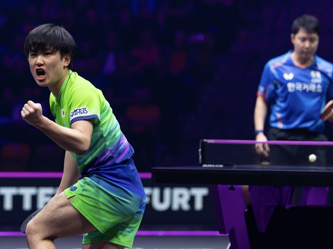

11月6日晚间，法兰克福冠军赛男单1/8决赛，排名世界第3的张本智和对阵世界第38的林锺勋。全场比赛，张本智和占据绝对主动，最终3-1取胜。日本选手共3人进入本站赛事的男单8强。

张本智和在首轮3-0击败了西多伦卡，展现了不俗的状态，而林锺勋则是在0-2的情况下逆转了卡尔伯格。此前，张本智和与林锺勋交手多次，张本智和的战绩占据优势。昨晚的比赛中，张本智和11-6拿下第一局。

林锺勋11-8扳回一局。不过，张本智和立刻做出调整，疯狂压制对手。接下来，张本智和用2个11-4赢下第3局、第4局。赢球之后，张本智和高举手臂，庆祝胜利，而林锺勋则有点崩溃，他这场比赛是完败。

赛后，张本智和称自己在赛前做足了准备：“要好好去准备，然后在比赛中调整。看今天我的状态，对方的状态，表现得怎么样，动脑子去想，然后能战胜比赛就很好。”

本站赛事的8强已经全部出炉，日本队有3人晋级，而中国队只有1人。

附法兰克福男单8强及对阵形势：

松岛辉空（日本）VS弗朗西斯卡（德国）

户上隼辅（日本）VS维东斯霍特（德国）

林昀儒（中国台北）VS温瑞博（中国）

邱党（德国）VS张本智和（日本）

特别声明：以上内容(如有图片或视频亦包括在内)为自媒体平台“网易号”用户上传并发布，本平台仅提供信息存储服务。

Notice: The content above (including the pictures and videos if any) is uploaded and posted by a user of NetEase Hao, which is a social media platform and only provides information storage services.

主宰稳场 2026-11-07 00:19:36

自己撑起一片天 2026-11-07 04:22:41

下次再见吧 2026-11-07 01:20:34

是呆熊吐泡泡 2026-11-07 01:26:07

朴朴实实的情 2026-11-05 04:44:21

辛苦的啊欣啊 2026-11-06 04:12:42

众生的世界观 2026-11-07 04:00:31

搞笑的八爪鱼 2026-11-03 19:33:12

暮色安然p 2026-11-05 08:27:38

老涺学科普 2026-11-05 04:30:26

老涺学科普 2026-11-05 04:29:06

夏末的晨溪 2026-11-07 04:47:02

君马体育 2026-11-06 22:25:08

大嘴说台球 2026-11-07 00:07:50

老涺学科普 2026-11-07 04:25:38

德瀚文 2026-11-05 01:46:22

夏末的晨溪 2026-11-07 04:43:06

心妍的家 2026-11-07 03:20:19

明媚如初k 2026-11-06 00:47:21

夏末的晨溪 2026-11-04 16:42:55

钉钉陌上花开 2026-11-07 05:45:12

编织教程啊 2026-11-05 04:27:07

风吹一生v 2026-11-05 02:56:19

钉钉陌上花开 2026-11-07 05:58:52

马克餐饮日记 2026-11-06 04:11:21

悉牛一荞木芷 2026-11-05 05:52:46

远梦归晓r 2026-11-05 02:10:03

秋Tian动漫 2026-11-04 10:59:06

人间闲散客 2026-11-05 01:45:59

九分看世界 2026-11-06 04:54:26

安若浅溪b 2026-11-07 03:48:37

杨哥乒乓 2026-11-06 21:21:37

独坐山巅前 2026-11-05 08:01:46

青树柠檬q 2026-11-06 00:37:30

江西都市现场 2026-11-06 10:39:27

中安在线 2026-11-06 11:38:22

国+社区 2026-11-06 08:42:35

看尽人间百态 2026-11-07 05:11:14

沐小作爱生活 2026-11-07 01:47:33

搞笑小王纸 2026-11-04 13:30:48

## 配图

图：乒乓球（网易体育 · 2026-11-07）

## 来源

- [网易体育 · 原文](https://www.163.com/dy/article/LB44Q1OM05566VBM.html)
