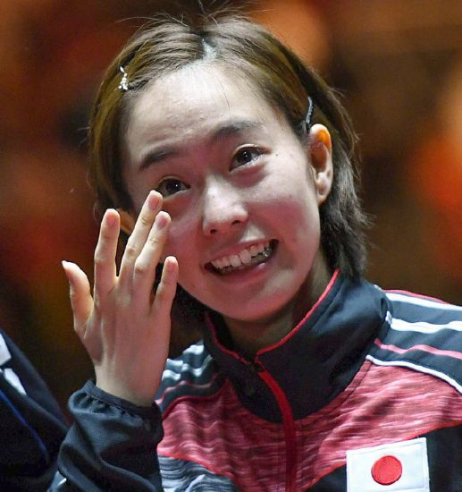

北京时间11月25日，33岁的前日本乒坛一姐石川佳纯正式官宣结婚，她曾经是伦敦、里约、东京三届奥运会团体奖牌得主，她的丈夫身份并未对外公布。

石川佳纯发布结婚公告如下：

我很高兴地宣布，我已经和交往一段时间的男友结婚。在相处的过程中，我意识到我想和他共度余生。

我们虽然经验尚浅，但希望能够互相扶持，共渡难关，共同建立一个充满欢声笑语的幸福家园。

我们衷心感谢您的温暖支持和鼓励，我再次由衷地感谢所有从我小时候就支持我的人。

我将继续努力，向世人展现乒乓球及其他运动的魅力。

33岁的石川佳纯作为日本前乒乓球一姐，她是伦敦、里约、东京三届奥运会团体奖牌得主。石川佳纯在2023年退役，她退役后从事体育解说、推广相关工作。

如今石川佳纯通过社媒官宣结婚，发布自己的结婚公告，但她没有公开丈夫的身份信息。

特别声明：以上内容(如有图片或视频亦包括在内)为自媒体平台“网易号”用户上传并发布，本平台仅提供信息存储服务。

Notice: The content above (including the pictures and videos if any) is uploaded and posted by a user of NetEase Hao, which is a social media platform and only provides information storage services.

新民周刊 2026-11-25 09:06:31

泰州微视听 2026-11-25 08:39:48

中国经济网 2026-11-23 17:47:08

极目新闻 2026-11-25 18:42:19

极目新闻 2026-11-25 19:23:29

新华社 2026-11-25 05:29:03

扬子晚报 2026-11-25 15:56:48

上游新闻 2026-11-25 12:09:07

新民周刊 2026-11-25 13:34:18

中国新闻周刊 2026-11-25 17:52:34

极目新闻 2026-11-25 13:24:23

极目新闻 2026-11-23 12:29:01

界面新闻 2026-11-24 21:13:57

看看新闻Knews 2026-11-25 17:02:28

齐鲁壹点 2026-11-25 09:51:08

央视新闻 2026-11-25 14:40:43

央视新闻客户端 2026-11-24 19:21:44

南方都市报 2026-11-25 11:02:31

澎湃新闻 2026-11-25 19:32:44

极目新闻 2026-11-25 20:48:48

网络辟谣 2026-11-25 19:19:10

现代快报 2026-11-25 20:49:38

极目新闻 2026-11-25 20:48:48

## 配图

图：乒乓球（网易体育 · 2026-11-25）

## 来源

- [网易体育 · 原文](https://www.163.com/dy/article/LCJ3D0RD0529RKNN.html)
