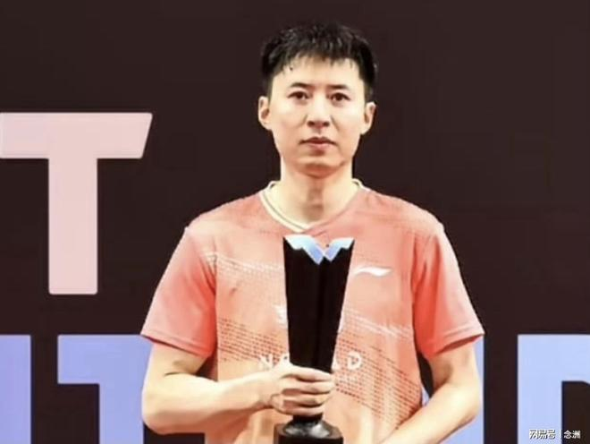

34岁的前国乒世界冠军方博代表哈萨克斯坦参赛，夺得了WTT伊斯坦布尔站的男单冠军，随后宣布退出后续赛事。回国之后，他进行直播，谈到未来可能遇到的强大对手。

方博目前世界排名已经升至第66，下一步的目标是能够直接参加大满贯的正赛。他跟网友互动，说道：“我相信你们肯定是愿意看我冲击这些顶尖运动员嘛，包括跟辉空打一场，跟张本打一场，想看我跟樊振东打一场啊，跟大头打一场啊，有的想看我被虐，正常，我尽可能的被虐的轻一点儿。”

此前的WTT阿拉木图站，方博输给了法国名将西蒙-高茨，他直言：“这个仇我是一定要报的，因为这一战让我受尽了侮辱，我必须要报这个仇。我被西蒙打成这样，你难道跟你们没有责任这个关系吗？”

方博在当主播的时候曾说过，“连西蒙都赢不了，还打什么乒乓球？”网友截屏传遍网络，西蒙都看过这个视频，“他下手确实有点狠了。我竞技状态那会儿还没调过来，没有那么好。再加上他憋着一堆火，我说他怎么不失误呢。当然这个仇我肯定是要报的。有机会碰到西蒙，我肯定是必须要搂他的。”

谈到参加比赛得花多少钱，方博表示：“按照周期算，不是一次算，准备打三年。如果经济身体允许，想多打。如果身体不允许，只能拼三年。直播赚经费，要不然球打不起，三年估计400-500万。直播不能停，要不然公司生存不下去。”

特别声明：以上内容(如有图片或视频亦包括在内)为自媒体平台“网易号”用户上传并发布，本平台仅提供信息存储服务。

Notice: The content above (including the pictures and videos if any) is uploaded and posted by a user of NetEase Hao, which is a social media platform and only provides information storage services.

浣溪爱球 2026-11-18 11:08:58

粘土手工 2026-11-17 00:56:59

月光婉儿f 2026-11-17 04:41:06

星耀球坛 2026-11-18 20:26:39

智慧教育空间站 2026-11-19 03:42:50

拾玖Talk 2026-11-19 19:13:14

江启 2026-11-19 12:25:19

人间闲散客 2026-11-18 00:48:08

念洲 2026-11-19 17:06:02

咪咕体育 2026-11-19 06:57:19

孤城落日 2026-11-19 01:38:54

Athlete体育 2026-11-17 09:32:42

于令 2026-11-17 03:48:52

独坐山巅前 2026-11-19 07:27:17

生活亨亨乐 2026-11-19 01:00:39

SilverLife银生活家 2026-11-18 04:07:32

梅花搞笑 2026-11-19 08:30:34

光影拾贝 2026-11-18 04:07:03

小齐艰难度日 2026-11-18 04:47:03

左脚爆射得分 2026-11-17 17:48:54

各地精彩不容错过 2026-11-19 04:54:54

九分看世界 2026-11-16 03:05:22

柏舟说娱i 2026-11-19 17:32:25

生活亨亨乐 2026-11-17 00:53:30

米修体育 2026-11-19 16:55:10

生活者工厂 2026-11-18 09:14:19

最佳菜鸟 2026-11-17 11:46:30

麦芽看世界 2026-11-18 01:37:44

小叶子侃球FM 2026-11-17 17:11:07

为了更好 2026-11-18 02:51:56

一寸时光a 2026-11-19 04:55:12

最佳菜鸟 2026-11-17 11:12:09

麻将的麻麻 2026-11-17 03:10:55

小叶子侃球FM 2026-11-18 20:12:20

凉了时光人 2026-11-19 01:47:24

三十六贱笑 2026-11-19 02:49:02

微微安x 2026-11-17 12:23:05

手工工作室 2026-11-17 01:19:21

冷白喵 2026-11-19 01:50:54

大王爆笑社 2026-11-17 16:50:07

## 配图

图：乒乓球（网易体育 · 2026-11-19）

## 来源

- [网易体育 · 原文](https://www.163.com/dy/article/LC31O6LH0553AOVQ.html)
