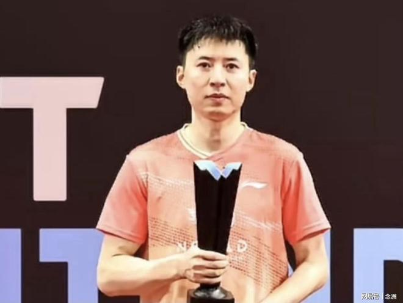

34岁的前国乒世界冠军方博代表哈萨克斯坦参赛，夺得了WTT伊斯坦布尔站的男单冠军，随后宣布退出后续赛事。回国之后，他进行直播，谈到未来可能遇到的强大对手。

方博目前世界排名已经升至第66，下一步的目标是能够直接参加大满贯的正赛。他跟网友互动，说道：“我相信你们肯定是愿意看我冲击这些顶尖运动员嘛，包括跟辉空打一场，跟张本打一场，想看我跟樊振东打一场啊，跟大头打一场啊，有的想看我被虐，正常，我尽可能的被虐的轻一点儿。”

此前的WTT阿拉木图站，方博输给了法国名将西蒙-高茨，他直言：“这个仇我是一定要报的，因为这一战让我受尽了侮辱，我必须要报这个仇。我被西蒙打成这样，你难道跟你们没有责任这个关系吗？”

方博在当主播的时候曾说过，“连西蒙都赢不了，还打什么乒乓球？”网友截屏传遍网络，西蒙都看过这个视频，“他下手确实有点狠了。我竞技状态那会儿还没调过来，没有那么好。再加上他憋着一堆火，我说他怎么不失误呢。当然这个仇我肯定是要报的。有机会碰到西蒙，我肯定是必须要搂他的。”

谈到参加比赛得花多少钱，方博表示：“按照周期算，不是一次算，准备打三年。如果经济身体允许，想多打。如果身体不允许，只能拼三年。直播赚经费，要不然球打不起，三年估计400-500万。直播不能停，要不然公司生存不下去。”

特别声明：以上内容(如有图片或视频亦包括在内)为自媒体平台“网易号”用户上传并发布，本平台仅提供信息存储服务。

Notice: The content above (including the pictures and videos if any) is uploaded and posted by a user of NetEase Hao, which is a social media platform and only provides information storage services.

极目新闻 2026-11-18 07:16:44

齐鲁壹点 2026-11-18 19:21:10

人民网-人民日报 2026-11-18 05:42:09

参考消息 2026-11-18 12:42:06

极目新闻 2026-11-18 10:22:19

上观新闻 2026-11-18 17:48:33

参考消息 2026-11-18 14:38:27

每日经济新闻 2026-11-18 07:56:11

新华社 2026-11-18 20:50:09

新华社 2026-11-18 20:04:33

财联社 2026-11-18 20:31:34

## 配图

图：乒乓球（网易体育 · 2026-11-19）

## 来源

- [网易体育 · 原文](https://www.163.com/dy/article/LC31O6LH0553AOVQ.html)
