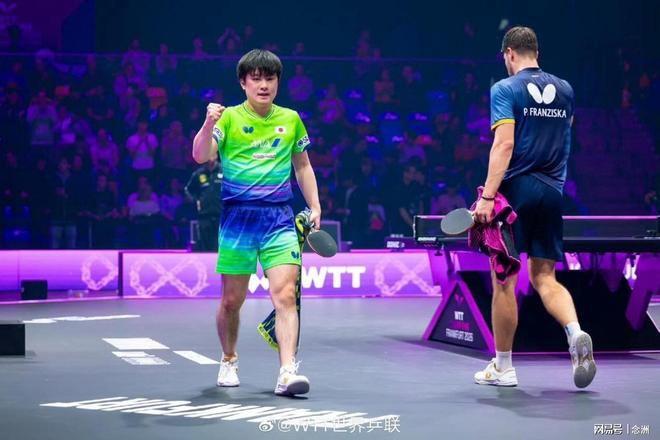

WTT2026法兰克福冠军赛男单决赛，日本选手张本智和4-2击败德国选手弗朗西斯卡，夺得冠军！

半决赛，张本智和4-3险胜林昀儒，弗朗西斯卡4-2击败户上隼辅，前者最新世界排名第三，后者最新世界排名第十五，此前一共交手十次，张本智和以九胜一负占据绝对的优势。

不过，弗朗西斯卡显然准备得更充分，首局就以11比2拿下。第二局虽然张本智和扳回一局，但是第三局弗朗西斯卡在2比10落后的情况下疯狂追分，最终以13比11奇迹般的赢下第三局。

大比分1-2落后，张本智和及时进行调整，11-8，11-4，11-4连扳三局，最终以总比分4比2战胜弗朗西斯卡，拿到法兰克福冠军赛男单冠军。

夺冠之后，张本智和张开双臂，怒吼庆祝，他霸气伸出一根食指，告诉大家：我才是第一！

这也是张本智和今年的第二个WTT冠军赛男单冠军，职业生涯的第4个冠军赛冠军，状态确实越来越出色了，也是国乒男队的最大对手之一。

特别声明：以上内容(如有图片或视频亦包括在内)为自媒体平台“网易号”用户上传并发布，本平台仅提供信息存储服务。

Notice: The content above (including the pictures and videos if any) is uploaded and posted by a user of NetEase Hao, which is a social media platform and only provides information storage services.

咪咕体育 2026-11-07 08:31:25

平行宇证h 2026-11-09 04:49:14

湘楚风云聊体育 2026-11-09 06:18:14

万物科普菌 2026-11-07 13:08:02

知识科普策 2026-11-07 13:14:15

众生的世界观 2026-11-07 04:00:31

悲惨鸭爱搞笑 2026-11-07 20:14:07

爆笑奇葩哥 2026-11-07 13:34:57

夏末的晨溪 2026-11-07 04:47:02

章民解说体育 2026-11-08 22:05:02

章民解说体育 2026-11-08 21:58:36

老涺学科普 2026-11-05 04:29:06

揭秘那些精彩 2026-11-08 15:43:00

君马体育 2026-11-06 22:25:08

心妍的家 2026-11-07 03:20:19

蚕听风 2026-11-09 05:06:40

言之有料 2026-11-08 13:37:11

莼侃体育 2026-11-08 10:33:57

草莓信箱 2026-11-09 00:14:30

凯叔闲聊 2026-11-08 00:31:46

西柚子动漫 2026-11-09 04:08:08

老涺学科普 2026-11-09 03:53:37

智慧教育空间站 2026-11-08 02:51:06

精灵之舞z 2026-11-09 03:04:00

草莓信箱 2026-11-09 00:10:23

侧身凌空斩 2026-11-09 04:29:29

一顿八斤米 2026-11-07 14:25:42

天思菱 2026-11-08 03:46:13

匠心体育 2026-11-08 10:04:59

跨越式 2026-11-08 09:53:44

莼侃体育 2026-11-08 09:39:10

望眼欲穿x 2026-11-09 04:18:53

让硪狠疲惫 2026-11-09 05:02:48

潘有辉骑行11周年 2026-11-08 03:01:25

草莓信箱 2026-11-09 00:08:59

李闯说生活 2026-11-07 15:11:52

你笑的好甜美 2026-11-09 05:16:47

荼蘼心虚 2026-11-09 01:41:55

快乐彼岸 2026-11-08 00:32:34

视角透析者 2026-11-09 03:59:22

## 配图

图：乒乓球（网易体育 · 2026-11-09）

## 来源

- [网易体育 · 原文](https://www.163.com/dy/article/LB99UATI0553AOVQ.html)
