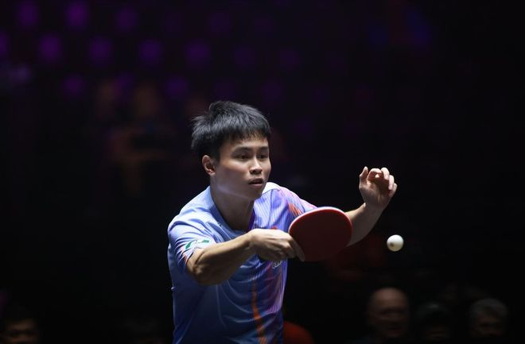

北京时间11月1日，WTT法国蒙彼利埃冠军赛刚刚结束了单打1/4决赛的全部较量。目前，男女单打4强已经全部诞生，半决赛的对阵正式出炉。

男单4强：19:30-雨果（6）vs张禹珍、20:15-莫雷加德（4）vs弗朗西斯卡

女单4强：18:00-蒯曼（5）vs陈熠、18:45-孙颖莎（2）vs王艺迪（4）

本站比赛进行到现在，可以说是冷门不断。精彩也不断。

女单方面，头号种子王曼昱在第2轮就被国乒队友陈熠横扫出局，无缘8强；3号种子张本美和被5号种子蒯曼4-2拿下，无缘4强；5号种子早田希娜面对2号种子孙颖莎，俩人均拼到力竭状态，轰出生涯最接近的1次对战。早田希娜决胜局惜败无缘4强，两人的交手纪录来到了0-22，赛后早田希娜流下了不甘的泪水；7号种子陈幸同也是经历了一场7局鏖战之后惜败出局无缘4强；8号种子、日乒削球名将直接被轰出4-0，无缘4强。

男单方面，日乒、法乒高手群全部提前出局。

日乒方面，头号种子松岛辉空在第2轮1-3败给了西多伦科，无缘8强；3号种子张本智和爆冷一轮游，被外卡提名获得参赛资格的东道主老将西蒙高茨3-0淘汰，无缘16强；另一位高手户上隼辅则是第2轮1-3不敌莫雷加德，无缘8强。

法乒方面，泊雷特0-3不敌莫雷加德，一轮游；7号种子大勒布伦2-3惜败，不敌弗朗西斯卡；2号种子小勒布伦则是1-3败给了周启豪，无缘8强。

男单1/4决赛，雨果击败西多伦科，张禹珍淘汰梁靖崑，莫雷加德险胜林诗栋，弗朗西斯卡险胜周启豪。至此，国乒男单全部出局，提前宣告连续3年在蒙彼利埃冠军赛无缘决赛阵容。

WTT法国冠军赛2026 | 男单1/4决赛

周启豪3-4弗朗西斯卡【15-13/5-11/11-7/9-11/9-11/12-10/10-12】

第一局俩人就展开激烈较量，一路从10-10平分到13-13，周启豪抓住战机连拿2分率先拿下1局，但随后5-11交出第二局，大比分战至1-1；第三局周启豪以11-7再度拿下超出大比分，但随后连续9-11丢掉了2局，反而是2-3落后面临绝境。关键的第六局，俩人又是一路胶着，周启豪12-10拿下之后进入到决胜局。

弗朗西斯卡决胜局前半段领先占优，周启豪末段追平反超比分，率先拿到赛点。10-9时，弗朗西斯卡反手拧拉直线晃到周启豪，后者直接倒地救球，遗憾未能得分，10-10之后弗朗西斯卡携“半个主场”的优势连续拿下2分，12-10拿下决胜局，以4-3惊险胜出！

今晚的半决赛，弗朗西斯卡将再战莫雷加德，萨尔布吕肯的队友相遇在4强战！

特别声明：以上内容(如有图片或视频亦包括在内)为自媒体平台“网易号”用户上传并发布，本平台仅提供信息存储服务。

Notice: The content above (including the pictures and videos if any) is uploaded and posted by a user of NetEase Hao, which is a social media platform and only provides information storage services.

国乒二三事 2026-11-01 05:24:22

聚焦热点直击 2026-10-29 09:54:10

梦史 2026-11-01 05:56:44

春若秋水 2026-10-31 01:18:23

老莫浅谈 2026-10-31 21:45:57

梧桐听雨l 2026-11-01 02:01:07

冰封情书熵增中r 2026-10-31 18:19:32

我是刘大悦le 2026-10-30 08:14:44

亿点点不一样 2026-10-31 17:08:47

为了更好 2026-10-30 04:39:46

刘刘说事 2026-11-01 00:48:02

手工编织教程 2026-11-01 00:08:34

触可及 2026-11-01 04:49:41

蓝天鹰击 2026-11-01 05:40:28

鲍向露 2026-11-01 05:22:12

咪咕体育 2026-10-31 04:30:22

咪咕体育 2026-10-31 04:32:05

一言手工 2026-10-31 17:05:09

咪咕体育 2026-10-31 04:32:01

篮球资讯达人 2026-11-01 01:07:01

九清怡 2026-10-31 03:30:41

马克餐饮日记 2026-11-01 04:27:40

案头聊文化 2026-11-01 03:55:16

于令 2026-10-30 02:11:58

阅尽天下精彩 2026-11-01 06:06:34

欢乐梦工厂 2026-10-30 11:10:58

七点人物志 2026-10-30 08:49:41

树懒小结界 2026-10-31 15:19:58

不多不少 2026-11-01 02:20:19

与笑相拥m 2026-11-01 03:38:13

主持人行行 2026-10-30 20:47:13

环球时报 2026-10-31 11:32:18

政知新媒体 2026-10-31 10:57:16

小郭聊球 2026-10-30 23:18:33

体育界小白 2026-10-31 07:42:00

大风新闻 2026-10-31 08:57:03

澎湃新闻 2026-10-31 19:29:27

我AI女排 2026-10-31 16:07:16

看看新闻Knews 2026-10-31 21:35:15

扬子晚报 2026-10-31 22:08:25

## 配图

图：乒乓球（网易体育 · 2026-11-01）

## 来源

- [网易体育 · 原文](https://www.163.com/dy/article/LAKHN88G0549HTER.html)
