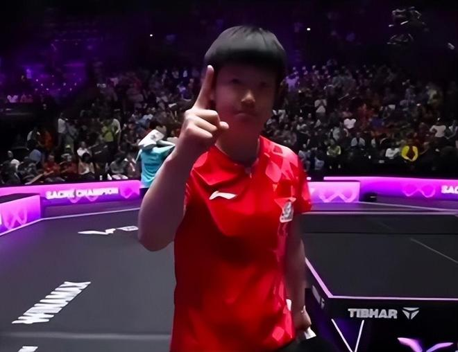

11月2日凌晨，WTT蒙彼利埃冠军赛女单决赛上演，对阵双方为2名中国选手孙颖莎及蒯曼。在先输一局的情况下，孙颖莎随后连赢四局。最终，孙颖莎4-1夺冠。赛后，她露出了久违的笑容。

8月份以来，孙颖莎长期受伤病困扰。在亚运会上，孙颖莎的整体表现不算出色。随后，她又退出了多站比赛。在蒙彼利埃复出后，孙颖莎也未能立刻找回最佳状态。

1/4决赛对阵此前从未输过的早田希娜，孙颖莎差点输球，最终4-3有惊无险地胜出。在半决赛对阵王艺迪的时候，孙颖莎3-0开局，却被对手连追3局，最后也是以4-3险胜。

进入到决赛，孙颖莎先输一局。落后的局面下，孙颖莎反而清醒了很多，她立刻调整，连赢4局，且第三局的比分是悬殊的11-3。孙颖莎如愿捧起冠军奖杯，再次证明了自己的实力。

赢球后，孙颖莎终于笑了，这是冠军的笑容，胜利的笑容，也是重压下释放的笑容。孙颖莎霸气竖起一根手指，似乎是在宣告自己的王者归来。

赛后，孙颖莎表示：“觉得首先还是非常开心吧，其实自己也时隔3个月，其实因为伤病再加上身体的一些原因，其实状态一直都在起起伏伏当中。我觉得每场都遇到了极大的困难，我觉得可能对于自己接下来也是有很大的帮助吧。”

孙颖莎拿起球拍，准备将手里的球打到看台上，送给观众。心情大好的她还做出了虚晃一枪的动作，逗笑了球迷。

同时，国乒官宣孙颖莎退出了接下来的WTT法兰克福冠军赛。看来，孙颖莎的伤病还没有完全康复。

特别声明：以上内容(如有图片或视频亦包括在内)为自媒体平台“网易号”用户上传并发布，本平台仅提供信息存储服务。

Notice: The content above (including the pictures and videos if any) is uploaded and posted by a user of NetEase Hao, which is a social media platform and only provides information storage services.

咪咕体育 2026-11-02 13:52:41

念洲 2026-11-02 18:22:49

咪咕体育 2026-10-31 04:31:43

猫熊说体育 2026-11-02 07:30:16

倾世璃歌 2026-11-02 18:43:49

咪咕体育 2026-10-31 04:32:00

伴你终老n 2026-11-02 00:16:19

老涺学科普 2026-11-02 02:47:13

半夏微凉qvq 2026-11-02 12:13:04

老侃体育圈 2026-11-01 20:33:10

咪咕体育 2026-11-02 13:52:38

旧城旧巷a 2026-11-02 10:32:25

只若初见h 2026-10-30 21:35:49

极目新闻 2026-11-02 18:39:31

跨越式 2026-11-02 17:28:54

篮球人物故事会 2026-11-02 16:56:13

凉了时光人 2026-11-02 18:47:50

泽哥说动漫 2026-11-02 04:32:18

精彩一网打尽 2026-11-02 02:47:22

为了更好 2026-11-01 07:41:08

马克餐饮日记 2026-11-01 04:27:40

九分看世界 2026-10-31 04:29:47

淺笑如夏 2026-11-02 06:23:46

月光倾城p 2026-11-02 13:13:23

久愛不變s 2026-11-01 22:59:54

极度说球 2026-10-31 22:34:02

我是六耳猕猴 2026-11-02 04:35:10

朴朴实实的情 2026-11-02 03:35:47

盛世论坛 2026-11-02 00:15:22

云雨生烟l 2026-10-31 17:10:04

阳光幽默馆 2026-10-31 14:29:11

右发新鲜事 2026-11-02 00:53:23

咪咕体育 2026-11-02 13:52:43

浅夏安然n 2026-11-02 07:22:09

阿嬍体育评论 2026-11-02 02:27:22

小车车和小刘刘 2026-11-02 05:46:21

小僫搞笑解说 2026-11-02 04:53:57

现代快报 2026-11-02 19:04:07

信网 2026-11-02 19:12:04

天津经开区一泰达 2026-11-02 19:39:56

## 配图

图：乒乓球（网易体育 · 2026-11-02）

## 来源

- [网易体育 · 原文](https://www.163.com/dy/article/LANARB9F05566VBM.html)
