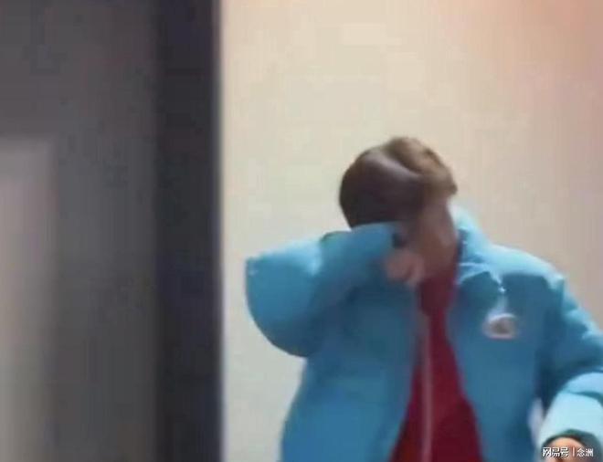

2026WTT法兰克福冠军赛1/4决赛结束，随着温瑞博0-4林昀儒，国乒男队全部无缘四强，而此前出局的王楚钦也引起热议。进行到了第五个比赛日。

0-3输给队友温瑞博之后，王楚钦并未立刻回国，还是住在法兰克福的酒店里。而根据网友的拍摄，他在酒店门口拿外卖，从状态来看，似乎并没有被输球所影响。

但从王楚钦点外卖来看，他心理上其实也是受到输球的影响了。因为按理说他应该去在法兰克福的街头逛一逛，吃点当地的特色美食，却选择在酒店里吃饭。

对此，有网友认为，这主要是现在热情的球迷太多，王楚钦出现在德国的街头很可能被围观，甚至有可能出现一些极端球迷直接去质问王楚钦为什么输球。

所以保险起见，王楚钦还是选择在酒店点外卖，而且从比赛来看，王楚钦的伤病应该也没有完全恢复，所以他也要多休息，争取伤病能够早日完全康复。

特别声明：以上内容(如有图片或视频亦包括在内)为自媒体平台“网易号”用户上传并发布，本平台仅提供信息存储服务。

Notice: The content above (including the pictures and videos if any) is uploaded and posted by a user of NetEase Hao, which is a social media platform and only provides information storage services.

政知新媒体 2026-11-07 21:28:51

澎湃新闻 2026-11-07 17:15:30

界面新闻 2026-11-07 21:21:22

央视新闻客户端 2026-11-07 02:16:11

参考消息 2026-11-07 17:58:12

中国新闻周刊 2026-11-07 10:01:01

北京网络举报 2026-11-07 11:39:53

极目新闻 2026-11-07 15:54:15

看看新闻Knews 2026-11-07 21:35:05

北青网-北京青年报 2026-11-07 14:42:05

南方都市报 2026-11-07 20:27:13

洪观新闻 2026-11-04 17:53:31

央视新闻客户端 2026-11-07 10:02:59

极目新闻 2026-11-07 22:24:26

扬子晚报 2026-11-07 08:59:35

澎湃新闻 2026-11-07 19:42:55

证券时报 2026-11-07 23:29:02

上观新闻 2026-11-08 06:24:33

## 配图

图：乒乓球（网易体育 · 2026-11-08）

## 来源

- [网易体育 · 原文](https://www.163.com/dy/article/LB6O2U2I0553AOVQ.html)
