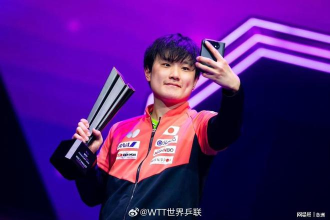

WTT法兰克福冠军赛男单决赛，日本选手张本智和4比2战胜德国选手弗朗西斯卡，获得男单冠军。夺冠之后，他接受了媒体的采访。

击败东道主夺冠，张本智和非常低调，他表示：“首先我想向弗朗西卡致以崇高的敬意。上周他在蒙彼利埃打进决赛，这次又是在他的主场德国作战。我明白他承受着多大的压力，因为我也曾在横滨有过同样的经历。他带着疲惫在德国站上赛场，我非常敬佩他。他打出了非常精彩的球，我们联手为大家奉献了一场精彩的对决，我由衷地开心，也十分敬重他。”

张本智和现在已经4次拿下冠军赛冠军，这也是今年第二个冠军赛头衔，这给他的WTT总决赛之旅增添信心：“冠军赛这项赛事我以往一年里最多只能拿一次冠军，像这样同一年拿下两次冠军还是头一回，真的很厉害。”

张本智和又发出豪言：“去年我已经拿下过总决赛冠军，这次夺冠无疑为冲击总决赛两连冠开了个好头。不过我身上还有不少需要改进的地方，回去之后我会好好训练大概一个月，以最好的状态奔赴总决赛。另外，我还从没在大满贯拿过冠军，明年我会努力争取拿下大满贯赛事的冠军。”

特别声明：以上内容(如有图片或视频亦包括在内)为自媒体平台“网易号”用户上传并发布，本平台仅提供信息存储服务。

Notice: The content above (including the pictures and videos if any) is uploaded and posted by a user of NetEase Hao, which is a social media platform and only provides information storage services.

寒士之言本尊 2026-11-09 18:16:50

咪咕体育 2026-11-07 08:31:25

颜小白的篮球梦 2026-11-09 10:32:33

万物科普菌 2026-11-07 13:08:02

娱说瑜悦 2026-11-09 18:20:53

悲惨鸭爱搞笑 2026-11-07 20:14:07

夏末的晨溪 2026-11-07 04:47:02

法老不说教 2026-11-09 17:48:11

跨越式 2026-11-09 11:20:41

章民解说体育 2026-11-08 22:05:02

章民解说体育 2026-11-08 21:58:36

跨越式 2026-11-09 10:44:43

老涺学科普 2026-11-05 04:29:06

君马体育 2026-11-06 22:25:08

老莫浅谈 2026-11-09 10:02:21

言之有料 2026-11-09 07:29:00

蚕听风 2026-11-09 05:06:40

言之有料 2026-11-08 13:37:11

神秘研究院 2026-11-09 12:24:12

咪咕体育 2026-11-09 17:49:21

老涺学科普 2026-11-09 03:52:14

奇史怪谈 2026-11-09 11:48:45

草莓信箱 2026-11-09 00:14:30

精灵之舞z 2026-11-09 03:04:00

凯叔闲聊 2026-11-08 00:31:46

西柚子动漫 2026-11-09 04:08:08

老涺学科普 2026-11-09 03:53:37

星视频 2026-11-09 15:22:25

等风上青云 2026-11-09 12:13:12

老莫浅谈 2026-11-09 12:12:46

知识科普策 2026-11-09 12:30:24

杨哥乒乓 2026-11-09 09:15:29

主宰稳场 2026-11-09 19:07:28

开成运动会 2026-11-09 18:03:58

九分看世界 2026-11-09 03:56:41

荼蘼心虚 2026-11-09 01:41:55

烈火战鹰 2026-11-07 01:51:44

杨哥乒乓 2026-11-09 19:10:43

网球之家 2026-11-09 18:53:58

骄阳之夏明 2026-11-09 01:19:41

## 配图

图：乒乓球（网易体育 · 2026-11-09）

## 来源

- [网易体育 · 原文](https://www.163.com/dy/article/LB99VBJG0553AOVQ.html)
