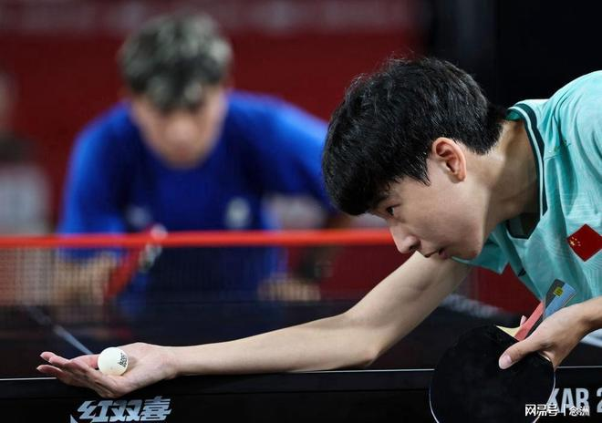

达喀尔青奥会乒乓球比赛，来自哥伦比亚的年轻新星埃马努埃尔·奥塔尔瓦罗获得男单银牌，他的母亲约兰达·加西亚接受媒体采访，其中谈到了中国乒乓球队，引起关注。

奥塔尔瓦罗目前在国际乒联U17世界排名中位列第二，仅次于日本选手川上流星。青奥会男单1/4决赛，他4-1击败中国选手李和宸，后者无缘半决赛，未能拿到奖牌。尔奥塔尔瓦罗最终在决赛中输给了川上流星，获得亚军。

事实上，国乒在本届青奥会上颗粒无收，创造历史最差战绩！混双方面，李和宸与姚睿轩在1/4决赛中1-3不敌日本组合川上流星/松岛美空，无缘四强。女单方面，姚睿轩在16强战以3-4不敌陈忞昕，无缘八强。

奥塔尔瓦罗的母亲在接受采访时说道：“说实话，孩子丢了金牌让我们很难过。但当小埃马努埃尔击败那个中国人的时候，我们太幸福了……在这里（指中国队），他们是王者：他们住在专属区域，有医生、理疗师、心理师、助手；甚至还有专人递水、照看风扇，因为这里热得让人受不了。那天所有人都来祝贺我们，告诉我们自2010年以来没人能打败他们。那太美好了。每一场比赛都是，看到孩子与那些如此优秀的亚洲选手对抗，他跟他们拼搏并战胜他们……太美妙了。”

可以看出，国乒的青奥会准备工作做得非常到位，坚持堪比奥运会的级别，可惜的是，唯独没有准备好拿金牌，甚至连奖牌都没拿到。

特别声明：以上内容(如有图片或视频亦包括在内)为自媒体平台“网易号”用户上传并发布，本平台仅提供信息存储服务。

Notice: The content above (including the pictures and videos if any) is uploaded and posted by a user of NetEase Hao, which is a social media platform and only provides information storage services.

扬子晚报 2026-11-10 12:58:55

北青网-北京青年报 2026-11-10 15:50:03

四川日报 2026-11-10 12:42:31

极目新闻 2026-11-10 08:00:38

环球网资讯 2026-11-10 16:20:46

封面新闻 2026-11-09 21:00:14

每日经济新闻 2026-11-10 16:04:03

新华社 2026-11-10 17:02:18

洪观新闻 2026-11-10 18:02:11

财联社 2026-11-10 15:06:39

环球网 2026-11-10 17:50:32

都市快报橙柿互动 2026-11-10 13:08:19

北青网-北京青年报 2026-11-10 16:12:49

环球网资讯 2026-11-10 08:32:14

澎湃新闻 2026-11-10 11:14:04

北京网络举报 2026-11-10 16:42:29

人民网 2026-11-10 06:39:14

## 配图

图：乒乓球（网易体育 · 2026-11-10）

## 来源

- [网易体育 · 原文](https://www.163.com/dy/article/LBD75ELS0553AOVQ.html)
