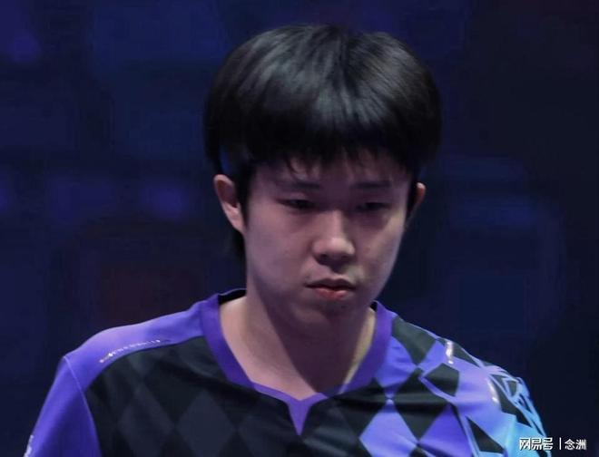

乒乓球奥运冠军王楚钦发文，表示自己在输球后不断反思总结，感谢教练、队友与团队的支持，将向着更高、更快、更强、更团结的目标共同前进，对此，前国手程靖淇进行了点评。

王楚钦的长文引起热议，程靖淇表示：“我觉得这个没有问题，更像是一种决心，就是说不辜负大家的这种期望，就是这口气，我能接受现在的结果，我也敢于说出我面对的自己的问题，我觉得非常好，也是一种担当。”

程靖淇认为：“安排王楚钦一个队长的角色，我觉得这不是包袱，这促使他成为了一个非常有担当的运动员。我觉得没关系，现在谁输都一样，你输也输，谁输都是输，我觉得起码在目前我们男线的这些运动员当中，王楚钦还是我们最大的底牌，这是实打实的。”

“近期我们确实看到，王楚钦在面对一些挑战的过程当中，在这样的一个时间节点，可以去冷静的思考，而且发自内心的去总结和去直面这些问题。我觉得这个这种行为远胜于他可能拿一站冠军，或者他去赢下某一场比赛，对于他来说帮助要大的更多。”

程靖淇直言：“首先这个问题不是王楚钦一个人身上的问题，为什么面临低谷？我们都要反思，为什么他那个时间段真空时间段，我们没有给他设立好他下一段的这种技术训练，战术训练？哪怕他节奏目标更高的这个节点，两年时间我们怎么安排？这是我们整体的问题。

特别声明：以上内容(如有图片或视频亦包括在内)为自媒体平台“网易号”用户上传并发布，本平台仅提供信息存储服务。

Notice: The content above (including the pictures and videos if any) is uploaded and posted by a user of NetEase Hao, which is a social media platform and only provides information storage services.

精彩一网打尽 2026-11-09 02:33:31

丁铗惊悚影视解说 2026-11-10 00:20:10

凉了时光人 2026-11-10 04:24:37

愿你余生安好嘴角带笑 2026-11-10 03:30:50

上易新鲜事 2026-11-07 08:58:25

聚焦事件 2026-11-09 03:55:19

狂战獠牙 2026-11-08 05:34:47

往日爱恨d 2026-11-08 04:52:04

重庆科教融媒体 2026-11-09 18:19:34

番茄肚腩 2026-11-07 13:08:12

左脚爆射得分 2026-11-07 11:22:28

四号花店p 2026-11-08 07:33:40

小叶子侃球FM 2026-11-09 00:49:56

凯叔闲聊 2026-11-08 00:31:46

邻家二蛋不靠谱 2026-11-10 02:29:00

此去经年q 2026-11-10 03:34:40

咪咕体育 2026-11-07 08:31:25

星河不入我 2026-11-10 01:28:57

春若秋水 2026-11-10 01:27:18

万物科普菌 2026-11-07 13:21:03

九分看世界 2026-11-09 03:56:41

九分看世界 2026-11-10 04:33:10

凯叔闲聊 2026-11-08 00:31:46

咪咕体育 2026-11-09 17:49:21

体坛侃侃球 2026-11-10 00:05:18

村里一枝花人 2026-11-10 05:05:15

阳光小筑Sunny 2026-11-08 04:13:36

斯帝卡V乒乓 2026-11-09 10:47:46

精彩一网打尽 2026-11-09 02:34:49

是蒜农高哥 2026-11-08 06:00:54

凌晨4点洛杉矶 2026-11-07 11:56:46

斯帝卡V乒乓 2026-11-09 10:15:50

晨初浮若 2026-11-09 04:51:59

老涺学科普 2026-11-10 04:19:50

星视频 2026-11-09 15:22:25

叹息的墙壁 2026-11-08 04:04:57

斯帝卡V乒乓 2026-11-09 09:48:50

李工木作设计 2026-11-09 00:49:12

淺笑如夏 2026-11-08 03:19:58

斯帝卡V乒乓 2026-11-07 10:16:07

## 配图

图：乒乓球（网易体育 · 2026-11-10）

## 来源

- [网易体育 · 原文](https://www.163.com/dy/article/LBBSK5NF0553AOVQ.html)
