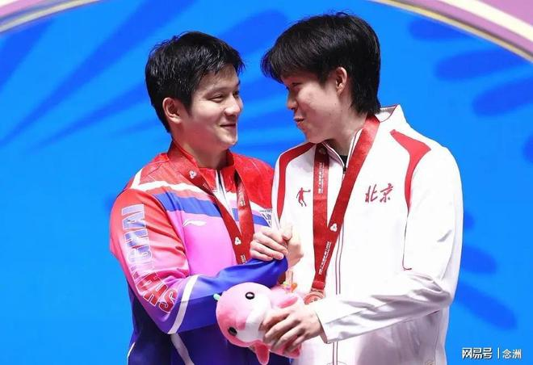

乒乓球奥运冠军王楚钦发布长文进行反思，广东媒体《羊城晚报》发表评论文章，结果引起争议。

王楚钦在WTT2026法兰克福冠军赛男单1/8决赛0比3输给年轻队友温瑞博，他发文承认自己这一段时间处在低谷，但也在反思和审视自己，表示正在不断的调整，希望能和队友们一起向着更高、更快、更团结、更强的目标前进。

很多球迷感受到了王楚钦的真诚，但《羊城晚报》评论道，反思写得再好，也不能替你在赛场上多拿一分，把“他说了什么”和“他接下来做了什么”分开看，是对一个职业运动员最基本的尊重。

文章还写道，他（王楚钦）说了要调整，那接下来的比赛就是答卷。打好了，这篇反思就是转折的起点；打不好，它至少也是一次诚实的自我审视，而不是一次敷衍的表态。

然而，“王楚钦反思长文被指双标对待”的词条却登上热搜高位，为何这么说呢？因为有网友发现，同样是《羊城晚报》，对待广州人樊振东输球的态度截然不同。

2026-2027赛季乒乓球德国杯1/8决赛，樊振东效力的杜塞尔多夫1比3不敌奥克森豪森，止步16强。《羊城晚报》称赞樊振东是不屈战士，他第二盘3比1击败罗马尼亚小将莫维利亚努，为球队拿下唯一一分；第四盘再度登场，对阵户上隼辅，在0比2落后的绝境下顽强扳平，决胜局战至11平后以11比13惜败。四盘比赛，两名队友一分未得，樊振东一个人扛了两盘。

该媒体还表示，杜塞尔多夫的整体阵容厚度不够，过度依赖樊振东，户上隼辅又是超常发挥，并强调自离开国乒后，樊振东在陌生的环境中独自应对训练和生活，后勤保障较以往有所下滑，又因休赛期缺乏系统训练和正式比赛，恢复过程异常艰难。

因此，有网友表示，“羊城晚报被说评论樊振东和王楚钦的时候，搞双面标准。王楚钦输了就反思没用，樊振东输了就是不屈战士。”

当然，樊振东和王楚钦都是非常优秀的运动员，有输有赢也是比赛的常态，王楚钦公开表态反思总结，也是一种有担当的表现，媒体其实不必苛责。

特别声明：以上内容(如有图片或视频亦包括在内)为自媒体平台“网易号”用户上传并发布，本平台仅提供信息存储服务。

Notice: The content above (including the pictures and videos if any) is uploaded and posted by a user of NetEase Hao, which is a social media platform and only provides information storage services.

完善法 2026-11-11 18:11:57

精彩一网打尽 2026-11-09 02:33:31

咪咕体育 2026-11-09 17:49:21

丁铗惊悚影视解说 2026-11-10 00:20:10

斯帝卡V乒乓 2026-11-09 10:47:46

老涺学科普 2026-11-11 04:27:57

全言作品 2026-11-11 17:44:16

星视频 2026-11-09 15:22:25

聚焦事件 2026-11-09 03:55:19

小叶子侃球FM 2026-11-09 00:49:56

小叶子侃球FM 2026-11-10 17:25:41

重庆科教融媒体 2026-11-09 18:19:34

天注定 2026-11-11 12:26:25

跨越式 2026-11-10 11:01:08

番茄肚腩 2026-11-07 13:08:12

一抹红尘n 2026-11-08 07:32:14

聚焦热点内幕 2026-11-11 05:51:36

爱吃冰棍的小痞子 2026-11-11 08:15:00

Athlete体育 2026-11-09 18:44:37

沙溪解说 2026-11-11 03:03:57

神秘研究院 2026-11-09 12:36:14

邻家二蛋不靠谱 2026-11-10 02:29:00

久愛不變s 2026-11-09 08:31:08

阿泽奇幻之旅 2026-11-10 14:32:37

老涺学科普 2026-11-11 04:26:31

一寸时光a 2026-11-11 16:07:14

懒杨阳体坛 2026-11-11 18:07:18

九分看世界 2026-11-10 04:33:10

凯叔闲聊 2026-11-08 00:31:46

幼儿园扛把子2 2026-11-08 08:19:00

huaser不花 2026-11-10 22:41:40

春若秋水 2026-11-10 01:27:18

独坐山巅前 2026-11-09 11:56:10

阳光小筑Sunny 2026-11-08 04:13:36

往日爱恨d 2026-11-11 12:16:05

黄小仙的搞笑视频 2026-11-11 19:04:38

李工木作设计 2026-11-09 00:49:12

一袭纸鸢w 2026-11-11 15:06:19

斯帝卡V乒乓 2026-11-11 09:13:59

麦芽看世界 2026-11-10 02:01:09

## 配图

图：乒乓球（网易体育 · 2026-11-11）

## 来源

- [网易体育 · 原文](https://www.163.com/dy/article/LBFOJT9M0553AOVQ.html)
