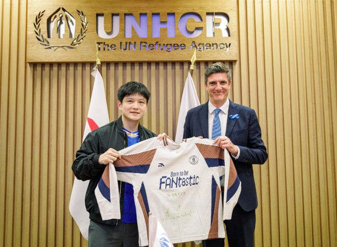

近日，国乒奥运冠军樊振东出席其代言厂商与联合国难民署合作的签约活动。期间，樊振东上台发表讲话，重点强调了体育与慈善的意义。他希望更多的人能够得到启程的机会。

11月9日，安踏集团与联合国难民署（UNHCR）在日内瓦的联合国难民署总部会面，双方签下了“体育照亮未来”（Moving for Change）项目新三年全球战略合作协议。未来3年，安踏集团继续支持全球人道主义行动。

安踏集团向联合国难民署提供了150万美元现金和120万件运动装备，支持非洲埃塞俄比亚、肯尼亚、布隆迪等地被迫流离失所的30万青少年。预计到2029年，该项目实施六年将累计惠及60万青少年。

作为安踏集团的代言人，樊振东表示：“体育带给我的，不只是赛场上的经历，更是面对困难时的信心，以及与他人并肩努力的力量。我希望被迫离开家园的孩子们能有机会参与运动，在运动中结识伙伴、获得快乐。”

活动结束后，樊振东还专门发文：“我始终相信，体育不应该只是少数人的竞技舞台，而应该是每个人都能参与、都能从中汲取力量的共同语言。无论身处何种境遇，每个孩子都应该拥有出发的自由、追梦的机会，以及相信未来的勇气。”

他表示：“体育的意义，不只是更快更高更强，也在于让更多人得到启程的机会。”

特别声明：以上内容(如有图片或视频亦包括在内)为自媒体平台“网易号”用户上传并发布，本平台仅提供信息存储服务。

Notice: The content above (including the pictures and videos if any) is uploaded and posted by a user of NetEase Hao, which is a social media platform and only provides information storage services.

青色雨音r 2026-11-11 02:04:44

各地精彩不容错过 2026-11-09 05:05:41

咪咕体育 2026-11-09 17:49:21

九分看世界 2026-11-10 04:33:10

星视频 2026-11-09 15:22:25

洒脱一点p 2026-11-11 04:31:19

老涺学科普 2026-11-11 04:27:57

爱吃冰棍的小痞子 2026-11-11 02:15:59

精彩一网打尽 2026-11-09 02:33:31

为了更好 2026-11-10 04:19:15

阿银紫 2026-11-09 09:38:45

丁铗惊悚影视解说 2026-11-10 00:20:10

小叶子侃球FM 2026-11-11 00:04:34

暮云初见c 2026-11-11 03:36:46

Athlete体育 2026-11-09 18:44:37

一抹红尘n 2026-11-08 07:32:14

斯帝卡V乒乓 2026-11-09 10:47:46

久愛不變s 2026-11-09 08:31:08

神秘研究院 2026-11-09 12:36:14

究竟谁主沉浮 2026-11-11 05:24:56

精彩一网打尽 2026-11-09 02:34:49

枫树林 2026-11-11 03:53:36

青树柠檬q 2026-11-09 06:39:27

老涺学科普 2026-11-10 04:22:24

丁铗惊悚影视解说 2026-11-10 00:21:27

言之有料 2026-11-10 14:03:54

跨越式 2026-11-10 11:01:08

沙溪解说 2026-11-11 03:03:57

过期少女致幻录 2026-11-11 05:11:38

观点机构 2026-11-11 01:41:00

腾飞之笑 2026-11-08 15:00:33

中国经济网 2026-11-07 09:16:03

孤城落日 2026-11-09 22:42:06

张民读史 2026-11-10 00:28:00

足球印象CC 2026-11-10 10:04:30

吕喆有话说 2026-11-08 15:51:43

主持人杨杨 2026-11-09 17:57:46

军武时间线 2026-11-08 16:20:05

古古聊军事 2026-11-09 20:06:42

星岛记事 2026-11-11 01:44:42

## 配图

图：乒乓球（网易体育 · 2026-11-11）

## 来源

- [网易体育 · 原文](https://www.163.com/dy/article/LBEEPRHI05566VBM.html)
