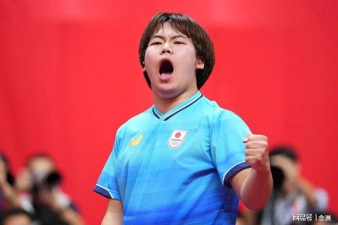

近日，日本乒乓球运动员松岛辉空接受媒体专访，谈到了亚运会上的表现。

谈到亚运会男团被王楚钦逆转，松岛辉空表示：“我觉得王楚钦当时有一种自己输了，整个队伍就输了的决心，自己在求胜欲上输给了他，当时我以2比0领先，前两局赢得比较轻松，所以心态上有些松懈，这也说明我在团体赛方面，还是缺乏一些经验。”

谈到亚运会男团对阵中国第五盘出场，松岛说道：“对中国队没有过，因为张本智和已经拿下了两分，所以如果打到第五盘，我觉得自己一定能赢，上场前我真的非常有信心。”

谈到队友张本智和的表现，松岛称赞道：“能在那种情况下拿下两分，作为球队的一号出场，稳稳拿下两分，对整个队伍来说真的很让人安心，我是真的觉得他很强。他当时直接跟我说我会赢的，你等着就好，结果他真的赢了，我觉得他确实很厉害，大概就是这样的感觉。一开始我还在想，真能赢啊？但毕竟他之前也有过一人拿下两分的经历，所以我觉得他应该能赢，直到比赛结束前，我都一直盯着屏幕看他的比赛，最后他真的赢了，确实很厉害。”

谈到亚运会男单输给林诗栋，松岛表示：“那场比赛我觉得主要还是输给了疲劳，同时参加四个项目，确实消耗很大，但对我来说，疲劳还是最大的原因。当然，林诗栋那天的发挥简直达到了200%，我从没见过他那么激动地庆祝，感觉他真的非常兴奋。”

特别声明：以上内容(如有图片或视频亦包括在内)为自媒体平台“网易号”用户上传并发布，本平台仅提供信息存储服务。

Notice: The content above (including the pictures and videos if any) is uploaded and posted by a user of NetEase Hao, which is a social media platform and only provides information storage services.

以战之名 2026-11-20 07:21:31

领略非凡 2026-11-22 02:56:31

蓝飘飘fly 2026-11-21 12:38:28

哈哈侠客行 2026-11-20 11:34:43

阿讯说天下 2026-11-21 08:02:33

非帆Jeff 2026-11-20 06:23:08

精彩背后的故事 2026-11-19 04:35:56

孤城落日 2026-11-19 01:38:54

小叶子侃球FM 2026-11-19 22:36:44

小驿拍客在北漂 2026-11-22 01:38:53

带你领略快乐真谛 2026-11-22 01:41:20

时光礼记p 2026-11-21 07:35:38

比特前沿报 2026-11-20 07:42:59

迎男而上 2026-11-21 00:45:45

夏末的晨溪 2026-11-22 04:13:18

张二要自律 2026-11-22 03:52:43

领略非凡 2026-11-22 02:52:36

为了更好 2026-11-20 03:49:33

人间闲散客 2026-11-20 00:01:05

麦芽看世界 2026-11-20 02:04:42

两心相忆f 2026-11-22 04:47:27

舌尖探店官 2026-11-21 10:35:40

星视频 2026-11-20 17:54:57

体坛亦说 2026-11-21 14:41:42

老涺学科普 2026-11-19 15:09:37

老涺学科普 2026-11-19 13:51:50

夏时情绪 2026-11-21 04:08:54

山楂唠生活 2026-11-20 04:02:58

你笑的好甜美 2026-11-22 04:13:31

斗地主游戏 2026-11-22 04:50:03

走过海棠 2026-11-19 22:21:55

下班疯玩小吴 2026-11-21 01:17:23

神秘的未知领域 2026-11-22 03:27:12

三月八卦 2026-11-20 12:18:42

枫哥闲谈 2026-11-20 19:28:27

糖炒小栗子 2026-11-19 06:26:49

暮雨咋歇着 2026-11-22 01:19:45

九分看世界 2026-11-22 04:08:08

张硜卤说体育 2026-11-22 00:40:08

烟雨洛神生 2026-11-22 01:10:10

## 配图

图：乒乓球（网易体育 · 2026-11-22）

## 来源

- [网易体育 · 原文](https://www.163.com/dy/article/LCAPFGNK0553AOVQ.html)
