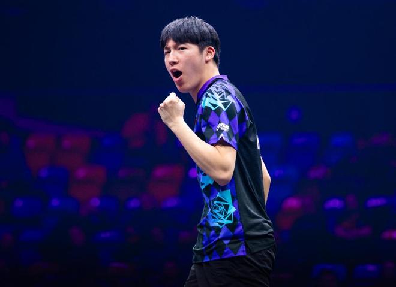

北京时间11月6日，2026年WTT法兰克福冠军赛的男单八分之一决赛全面打响，男单赛场迎来一场国乒德比战，世界排名第四的王楚钦，迎战小师弟温瑞博，之前一直处于养伤阶段的王楚钦，本场比赛状态不佳，在场上跟不上小师弟温瑞博的节奏，最终大比分0-3饮恨德比，止步法兰克福冠军赛男单十六强。

只有19岁的温瑞博，目前世界排名第十四位，本赛季一共出战了48场国际比赛，取得了33胜15负的战绩，胜率达到了69%，而王楚钦的表现明显更加出色，46场世界大赛以91%的胜率斩获42胜，不过王楚钦和温瑞博此前从未交过手，此战是二人生涯的国际大赛遭遇战。

在来到法兰克福之后，二人都展现出了非常出色的竞技状态，温瑞博第一轮干净利落横扫了韩国名将安宰贤，王楚钦也没有遇到太大的阻力，轻松以大比分3-0击败了来自丹麦的林德。

尽管这一场比赛是两名选手在国际赛场的首次碰面，但是作为国家队的队友，二人对于彼此都非常熟悉，因此首局一上来就在前三板做文章，想要率先获得上手进攻的机会，王楚钦开局阶段利用更高的单板质量，压制住了小师弟，很快建立起了4-2的领先。

不过抱着挑战者心态的温瑞博，没有受到任何的干扰，通过大范围的落点变化，给自己侧身创造出了空间，连续高质量的爆冲，让其迅速追平了比分，并且在二人激战至7平之后，温瑞博突然发力，直接连得4分以11-7取得了开门红。

拿下首局给了温瑞博自信心上的极大提升，第二局继续坚持进攻打法的温瑞博，出手质量更高，如愿在开局阶段压制住了王楚钦，很快建立起了5-2的领先，非常清楚这一局重要性的大头，虽然也没有放弃，一直在努力追分，但稳扎稳打的温瑞博没有给他逆转的机会，如愿以11-8的比分再下一城。

已经不能再输的王楚钦，第三局一上来就利用接发球抢攻拿下第一分，但是在温瑞博祭出中间位劈长后，大头逐渐失去了自己的节奏，眼睁睁看着小师弟打出一波得分小高潮之后，将比分反超为了5-2，在主动调整站位后撤一小步后，王楚钦逐渐扭转了颓势，连追2分，将分差迫近到了只有1分，不过温瑞博没有给对手追平的机会，关键时刻再度发力重新拉开比分，最终也以11-6锁定了胜局。

昂首晋级本站赛事男单八强的温瑞博，下一轮的对手将会是国乒主力周启豪和中国台北名将林昀儒之间的胜者，期待近几站世界大赛打出不错表现的周启豪，能够延续火热的状态，力争击败实力不俗的林昀儒和温瑞博胜利会师，帮助国乒预定一张男单四强的门票。

特别声明：以上内容(如有图片或视频亦包括在内)为自媒体平台“网易号”用户上传并发布，本平台仅提供信息存储服务。

Notice: The content above (including the pictures and videos if any) is uploaded and posted by a user of NetEase Hao, which is a social media platform and only provides information storage services.

扬子晚报 2026-11-03 07:20:39

中国新闻周刊 2026-11-05 07:25:03

浙江发布 2026-11-05 16:55:52

洪观新闻 2026-11-05 16:54:28

北京日报 2026-11-05 15:23:59

大风新闻 2026-11-05 09:28:05

看看新闻Knews 2026-11-05 09:42:26

极目新闻 2026-11-05 16:28:15

极目新闻 2026-11-05 07:33:16

洪观新闻 2026-11-04 17:53:31

界面新闻 2026-11-05 10:32:56

极目新闻 2026-11-05 08:43:21

极目新闻 2026-11-05 10:10:16

每日经济新闻 2026-11-05 23:02:24

澎湃新闻 2026-11-05 14:52:27

北京网络举报 2026-11-05 18:46:54

新浪财经 2026-11-06 05:56:42

新浪财经 2026-11-06 05:49:44

农视网 2026-11-06 06:07:38

## 配图

图：乒乓球（网易体育 · 2026-11-06）

## 来源

- [网易体育 · 原文](https://www.163.com/dy/article/LB1HKL5K0549753N.html)
