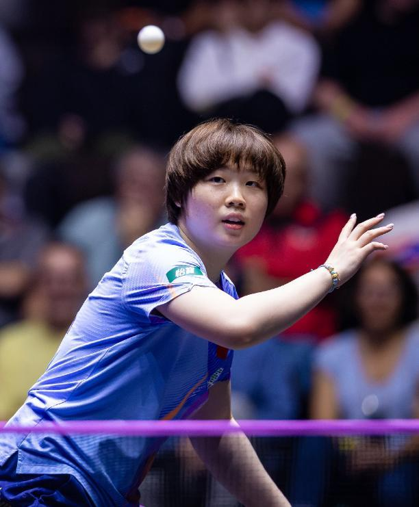

2026年WTT蒙彼利埃冠军赛，在经历多日的鏖战之后，半决赛对阵已经全部产生，国乒女队延续了强势的发挥，包揽了全部四强名额，首场对决新科亚锦赛冠军陈熠和蒯曼狭路相逢，本场比赛蒯曼多变的打法，让陈熠没有发挥出自己单板质量高的优势，只能眼睁睁看着大丫头以4-2获胜晋级。

同为22岁的陈熠和蒯曼，凭借自己的天赋和努力，都已经跻身国乒主力的行列，二人世界排名都位列前十，可见整体实力非常强，在过往的世界大赛上，两名选手也有过9次正面交锋，大丫头取得了5胜4负的战绩，但最近的一次碰面，她却吞下了失利的苦果，那是在上赛季的美国大满贯上，陈熠经历七局鏖战，以4-3艰难击败了蒯曼。

作为非种子选手，陈熠本站赛事的状态非常出色，首战3-1击败彭郁涵（中国台北）后，连续横扫了世界排名第一的师姐王曼昱和削球名将佐藤瞳（日本），反观蒯曼的晋级之路略显坎坷，前两轮都是3-2险胜安娜赫西（威尔士）和迪亚兹（波多黎各），上一轮则以4-2击败了张本美和（日本）。

首局比赛开打之后，两名选手都在想尽办法发挥自己的强项，直接把单板质量拉满的陈熠，早早建立起了4-2的领先，但蒯曼利用台内的挑打，迅速追平比分，随后二人进入拉锯战，交替领先一直打到11平，决胜时刻，蒯曼反手变线连续造成陈熠失误，以13-11先拔头筹。

第二局比赛陈熠心态方面有一些变化，急于取得领先扳平大比分，反而让自己的出手不够合理，只要出现回球不到位的情况，以蒯曼如今的能力，就能够把握住形成主动得分，在自己的节奏中，大丫头很快就确立起了8-2的领先，并且轻松以11-5再下一城。

连输两局的陈熠，第三局加快了自己前三板的发动，强势建立起了3-0的领先，但是在蒯曼发挥出自己反手的优势之后，频频高质量变直线突击得手，回敬一波得分小高潮之后，在中局阶段将比分反超为了6-3，不过在陈熠加强针对性的防守后，重新掌控局面，以11-8扳回一局。

第四局蒯曼主动求变，没有一味用自己强势的反手和陈熠对抗，而是加强了自己正手的侧身爆冲，突然的打法变化，也让陈熠准备不足，出奇制胜的大丫头如愿建立起了5-1的优势，并且一鼓作气以11-6进入自己的赛点局。

背水一战的陈熠，第五局直接把自己的接发球质量拉满，也取得了预期的效果，在二人紧咬比分打到3平之后，直接轰出一波得分高潮，在局末以10-4遥遥领先，在蒯曼挽救2个局点后，陈熠一锤定音以11-6再赢一局。

起势的陈熠，第六局一上来没有给蒯曼任何机会，高质量的突击，让其强势建立起了6-0的优势，不过大丫头并没有放弃，稳住阵脚后开始追分，顽强在局末阶段，将比分追至9平，心态失衡的陈熠关键时刻回球质量不高，让蒯曼抓住机会以11-9锁定胜局。

特别声明：以上内容(如有图片或视频亦包括在内)为自媒体平台“网易号”用户上传并发布，本平台仅提供信息存储服务。

Notice: The content above (including the pictures and videos if any) is uploaded and posted by a user of NetEase Hao, which is a social media platform and only provides information storage services.

参考消息 2026-10-31 20:35:09

政知新媒体 2026-11-01 15:18:21

看看新闻Knews 2026-10-31 21:35:15

大风新闻 2026-10-31 22:04:03

江南晚报 2026-11-01 12:18:22

都市快报橙柿互动 2026-11-01 16:07:04

新京报 2026-11-01 11:46:23

扬子晚报 2026-10-31 19:54:41

现代快报 2026-11-01 15:59:11

环球网资讯 2026-11-01 17:25:17

日照日报 2026-10-31 22:02:00

国际在线 2026-10-31 20:57:27

文汇报 2026-11-01 15:11:04

农视网 2026-11-01 16:37:38

19楼 2026-11-01 19:37:01

江津融媒 2026-11-01 19:35:39

## 配图

图：乒乓球（网易体育 · 2026-11-01）

## 来源

- [网易体育 · 原文](https://www.163.com/dy/article/LAM0LEAD0549753N.html)
