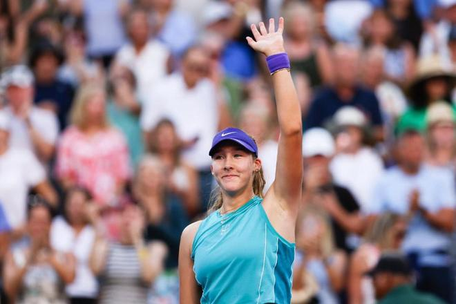

11月15日，WTA年终总决赛半决赛比赛进行。3号种子安德列娃直落两盘击败了5号种子佩古拉，职业生涯首次入围总决赛就以一盘未失的成绩强势挺进决赛。这场比赛的胜利，帮助安德列娃锁定了今年的WTA年终世界第2。

今年的年终总决赛安德列娃状态可谓非常强势，小组赛面对世界排名第2的萨巴伦卡和第6的斯维托丽娜，安德列娃均打出了6-0送蛋的表现。最后一轮面对替补出战的施耐德，安德列娃仅仅丢掉了3局。

从小组赛首场比赛到半决赛结束，安德列娃在4场比赛总共仅仅丢掉了18局。根据数据统计显示，安德列娃是2003年WTA总决赛重新引入小组循环赛以来，跻身决赛丢掉局数最少的选手。此前这一纪录是由2007年的海宁（19）和2023年的斯瓦泰克（19）所保持。

同时安德列娃还成为了WTA总决赛历史上，第3位在自己前4场比赛均直落两盘取得胜利的选手，此前2位分别是埃弗顿和小威廉姆斯。

安德列娃还是过去22年最年轻的WTA年终总决赛决赛选手，上一次有比她更年轻的选手闯入总决赛争冠战，还要追溯到2004年的莎拉波娃。

事实上从今年9月底的中网比赛开始，安德列娃的状态一直非常出色。过去10场比赛安德列娃取得了9胜1负的成绩。唯一的一场失利，是在中网决赛的比赛中0-2输给了中国金花郑钦文。

特别声明：以上内容(如有图片或视频亦包括在内)为自媒体平台“网易号”用户上传并发布，本平台仅提供信息存储服务。

Notice: The content above (including the pictures and videos if any) is uploaded and posted by a user of NetEase Hao, which is a social media platform and only provides information storage services.

世界体坛观察家 2026-11-15 06:20:12

侧身凌空斩 2026-11-15 06:16:32

刘姚尧的文字城堡 2026-11-15 06:06:47

老莫浅谈 2026-11-14 07:06:36

刘姚尧的文字城堡 2026-11-15 06:34:29

台球Numberone 2026-11-15 06:32:59

爱体育的小悠悠 2026-11-15 02:28:12

锐评利物浦 2026-11-14 18:29:24

主持人行行 2026-11-12 17:40:57

晚风知我意21 2026-11-15 03:57:33

探山城 2026-11-13 10:56:39

篮球过人技巧 2026-11-12 14:08:07

参考消息 2026-11-13 20:26:04

猫眠花下t 2026-11-13 03:14:49

一溪风月w 2026-11-15 03:51:23

安全与法 2026-11-13 15:13:18

咪咕体育 2026-11-14 12:20:58

微微安x 2026-11-12 05:52:09

全景体育V 2026-11-15 06:02:06

唐尼二爱生活 2026-11-14 09:01:33

精彩一网打尽 2026-11-15 02:45:53

慧点科普 2026-11-13 09:38:18

氧气周末 2026-11-13 12:05:41

扬子晚报 2026-11-14 11:14:48

星耀球坛 2026-11-14 23:53:13

贵圈星娱 2026-11-14 22:58:52

糖炒小栗子 2026-11-15 03:23:40

上班摸鱼一级选手 2026-11-13 01:14:35

封面新闻 2026-11-12 12:23:10

汪星人哟 2026-11-14 22:00:13

安全与法 2026-11-13 18:54:30

都市快报橙柿互动 2026-11-14 15:39:31

侃球熊弟 2026-11-14 21:32:14

每日经济新闻 2026-09-08 18:39:19

一抹宁静 2026-11-15 05:14:58

雨轩电影 2026-11-11 13:37:13

北青网-北京青年报 2026-11-12 21:26:04

环球网资讯 2026-11-14 07:45:05

澎湃新闻 2026-11-14 19:28:27

上游新闻 2026-11-14 17:07:05

## 配图

图：网球（网易体育 · 2026-11-15）

## 来源

- [网易体育 · 原文](https://www.163.com/dy/article/LBON0R0K0529TPTB.html)
