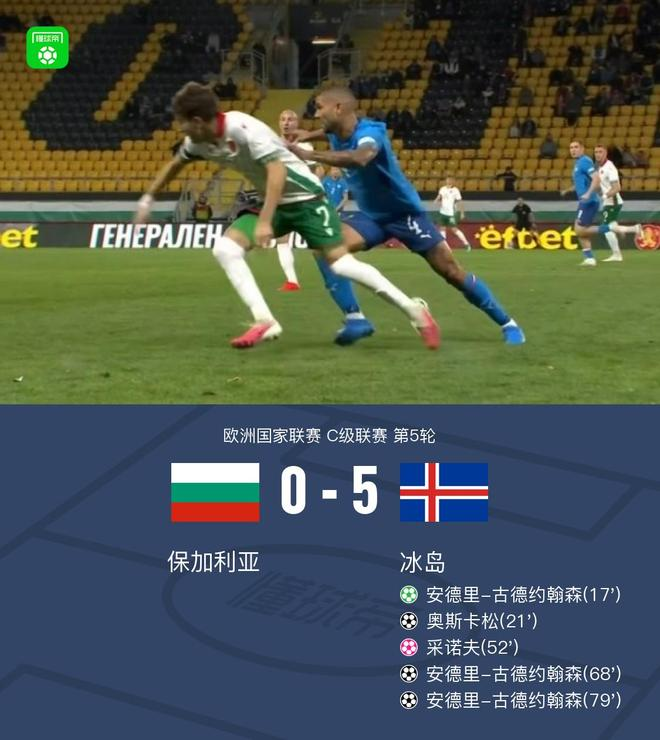

北京时间11月14日欧洲国家联赛 C级联赛 第5轮，保加利亚对阵冰岛。保加利亚采诺夫自摆乌龙。冰岛安德里-古德约翰森帽子戏法，奥斯卡松破门。最终比分保加利亚 0-5 冰岛。

第17分钟，奥斯卡松造点，古德约翰森主罚命中，冰岛1-0保加利亚

第21分钟，马格努松后场长传，奥斯卡松单刀破门将比分扩大，冰岛2-0

第52分钟，采诺夫不慎乌龙，冰岛3-0保加利亚

第68分钟，古德约翰森破门完成双响，冰岛4-0保加利亚

第79分钟，古德约翰森补射破门完成帽子戏法，冰岛5-0保加利亚

双方球员入场，比赛马上开始

第4分钟，冰岛开场采用高压逼抢战术，帕尔松身后撞人犯规

第9分钟，索尔达松腿部拉伤被换下，马格努松替补登场

第14分钟，中路直塞，埃勒特松插上射门直接放了高射炮

第17分钟，奥斯卡松造点，古德约翰森主罚命中，冰岛1-0保加利亚

第21分钟，马格努松后场长传，奥斯卡松单刀破门将比分扩大，冰岛2-0

第29分钟，佩特科夫底线倒三角传球，伊利耶夫的射门踢偏

第33分钟，奥斯卡松肋部斜塞至禁区，古德约翰森插上射门高出

第34分钟，埃勒特松右路传后点，托马松插上推射击中立柱弹出

第52分钟，采诺夫不慎乌龙，冰岛3-0保加利亚

第61分钟，肋部斜塞至禁区，伊利耶夫插上射门，皮球被瓦尔迪马尔松扑住

第68分钟，古德约翰森破门完成双响，冰岛4-0保加利亚

第79分钟，古德约翰森补射破门完成帽子戏法，冰岛5-0保加利亚

特别声明：以上内容(如有图片或视频亦包括在内)为自媒体平台“网易号”用户上传并发布，本平台仅提供信息存储服务。

Notice: The content above (including the pictures and videos if any) is uploaded and posted by a user of NetEase Hao, which is a social media platform and only provides information storage services.

懂球帝 2026-11-13 13:54:39

懂球帝 2026-11-13 19:34:49

懂球帝 2026-11-13 18:40:06

懂球帝 2026-11-13 19:56:12

蜡笔小新爱体育 2026-11-13 18:25:47

懂球帝 2026-11-14 04:34:06

懂球帝 2026-11-14 05:37:50

足球狗说 2026-11-14 06:07:07

栓Q笑料集 2026-11-11 14:54:18

追梦聊球 2026-11-13 10:48:58

篮球过人技巧 2026-11-12 18:12:11

于令 2026-11-12 03:25:11

林纸巾 2026-11-13 18:33:31

侧身凌空斩 2026-11-14 05:36:06

狍子歪解体坛 2026-11-13 06:25:09

懂球帝 2026-11-14 05:37:50

体坛周报 2026-11-13 09:12:23

林间小温柔 2026-11-14 06:21:26

球事百科吖 2026-11-14 06:22:11

球事百科吖 2026-11-14 06:23:45

球事百科吖 2026-11-14 06:25:03

环球时报 2026-11-13 08:33:44

雄韬伟略 2026-11-10 09:56:32

星视频 2026-11-13 10:39:41

参考消息 2026-11-13 20:26:04

环球网资讯 2026-11-12 23:52:06

不知名选手 2026-11-12 11:55:39

浙江新闻 2026-11-13 18:27:00

每日经济新闻 2026-11-13 19:29:25

地理百科世界 2026-11-11 12:14:48

古渡观书 2026-11-13 17:11:16

极目新闻 2026-11-10 08:00:38

青色雨音r 2026-11-12 01:38:49

扬子晚报 2026-11-11 07:52:23

星沙时报 2026-11-11 16:12:15

大风新闻 2026-11-13 14:57:03

澎湃新闻 2026-11-13 18:59:32

RT今日俄罗斯 2026-11-11 07:00:53

萌萌乐翔事 2026-11-12 02:46:37

车壹圈 2026-11-12 23:34:45

## 配图

图：网球（网易体育 · 2026-11-14）

## 来源

- [网易体育 · 原文](https://www.163.com/dy/article/LBM36HUQ0549BAP0.html)
