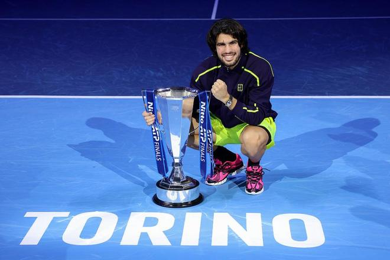

在北京时间11月23日结束的ATP年终决赛中，世界排名第3的阿尔卡拉斯以2-0战胜世界排名第1的兹维列夫，首夺年终总决赛冠军，达成“全满贯”伟业。

首盘比赛，阿尔卡拉斯3次破掉兹维列夫的发球局，以6-2先下一城。第2盘，阿尔卡拉斯在第3局率先破发，之后兹维列夫2-4落后连赢3局。随后，双方均未能破发，比赛进入抢七局。抢七局中，阿尔卡拉斯在3-2领先时连丢4分，之后他连得4分，最终阿尔卡拉斯奇迹挽救3个盘点，以9-7赢下第2盘抢七局，总比分2-0击败兹维列夫夺冠。

本场比赛获胜后，阿尔卡拉斯将自己与兹维列夫交手记录，改写为8-6领先，其中本赛季两次交手全部获胜。

这是阿尔卡拉斯本赛季第6个单打冠军和生涯第30个单打冠军，他也成为历史上第3位获得ATP年终总决赛单打冠军的西班牙球员。

23岁的阿尔卡拉斯成为继阿加西、费德勒和德约科维奇之后，男子网坛历史第4位实现全满贯，并获得ATP年终总决赛单打冠军的球员，同时也是最年轻达成此成就的球员。

5战全胜夺冠的阿尔卡拉斯，收获517.1万美元（约合3453万人民币）奖金和1500个世界排名积分，以世界排名第3收官（落后辛纳350分）。

特别声明：以上内容(如有图片或视频亦包括在内)为自媒体平台“网易号”用户上传并发布，本平台仅提供信息存储服务。

Notice: The content above (including the pictures and videos if any) is uploaded and posted by a user of NetEase Hao, which is a social media platform and only provides information storage services.

绿茵狂热者 2026-11-23 03:38:18

全景体育V 2026-11-23 05:18:14

竞技风云录 2026-11-23 04:21:00

侧身凌空斩 2026-11-23 03:17:02

爱情的滋味我也想尝尝 2026-11-23 04:59:08

网球之家 2026-11-22 14:32:15

网球之家 2026-11-22 18:56:42

主持人行行 2026-11-22 00:37:51

林间小温柔 2026-11-23 01:37:11

晚风知我意21 2026-11-23 02:22:36

网球之家 2026-11-16 10:15:17

月亮的麦片 2026-11-22 22:34:30

春若秋水 2026-11-23 01:31:04

新华社 2026-11-21 17:59:32

热血体育社 2026-11-23 04:35:41

懂球帝 2026-11-23 05:20:40

扬子晚报 2026-11-22 20:36:44

脑洞编剧小剧场 2026-11-23 01:47:16

大风新闻 2026-11-20 20:07:09

领略非凡 2026-11-22 02:52:36

扬子晚报 2026-11-22 20:21:58

都市快报橙柿互动 2026-11-22 00:21:20

上观新闻 2026-11-22 11:23:24

上观新闻 2026-11-22 20:26:26

思念幻化 2026-11-23 03:49:40

春若秋水 2026-11-22 01:37:33

每日经济新闻 2026-11-22 20:13:34

中国新闻周刊 2026-11-22 12:18:03

极目新闻 2026-11-21 18:14:13

蓝鲸新闻 2026-11-19 16:25:03

小狗漫说 2026-11-22 09:14:48

环球网资讯 2026-11-22 20:15:14

界面新闻 2026-11-20 16:42:26

足球故事GOAL 2026-11-22 14:40:34

云天之巅明 2026-11-20 21:37:55

大风新闻 2026-11-22 17:55:03

环球网资讯 2026-11-22 21:12:48

新华社 2026-11-22 19:00:24

扬子晚报 2026-11-20 07:36:45

澎湃新闻 2026-11-22 22:29:05

## 配图

图：网球（网易体育 · 2026-11-23）

## 来源

- [网易体育 · 原文](https://www.163.com/dy/article/LCD7V7LQ0529CA1F.html)
