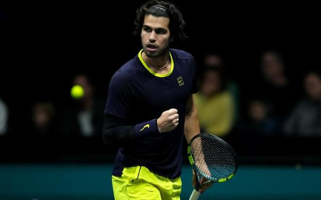

11月8日凌晨，ATP1000巴黎大师赛男单半决赛进行。赛会2号种子阿尔卡拉斯出战，对手是挪威名将鲁德。本场比赛阿尔卡拉斯直落两盘击败对手，将双方的交战记录改写为7胜1负，职业生涯首次在巴黎大师赛跻身决赛。

首盘比赛阿尔卡拉斯在第7局完成关键破发，随后他顺利保发取得5-3的领先优势。第10局阿尔卡拉斯在自己的发球胜盘局love game保发成功，6-4赢下了第一盘比赛的胜利。

第二盘阿尔卡拉斯在第9局破掉了鲁德发球局，5-4领先来到自己的发球胜赛局。第10局阿尔卡拉斯在发球胜赛局没有给对手机会，保发成功后6-4赢下了第二盘。

最终在一场耗时1小时26分钟的比赛当中，阿尔卡拉斯6-4/6-4战胜了世界排名23位的鲁德。获胜的阿尔卡拉斯取得了一波室内硬地8连胜，这是他首次在巴黎大师赛闯入决赛，第11次跻身1000赛决赛，第38次闯入巡回赛决赛。

接下来在周日的决赛当中，阿尔卡拉斯将同赛会3号种子谢尔顿隔网相对，争夺最后的冠军。交战记录方面，阿尔卡拉斯3胜1负占优。在两个月前的美网比赛中，谢尔顿曾五盘大战取得胜利。

特别声明：以上内容(如有图片或视频亦包括在内)为自媒体平台“网易号”用户上传并发布，本平台仅提供信息存储服务。

Notice: The content above (including the pictures and videos if any) is uploaded and posted by a user of NetEase Hao, which is a social media platform and only provides information storage services.

热血体育社 2026-11-08 06:01:34

主持人行行 2026-11-06 13:04:23

晚风知我意21 2026-11-08 02:51:55

一路荒凉如歌aa 2026-11-08 02:06:58

篮坛第一线 2026-11-08 03:35:40

侧身凌空斩 2026-11-08 05:28:19

主持人行行 2026-11-05 19:44:18

爱不爱都依你 2026-11-08 04:57:30

林间小温柔 2026-11-08 05:16:08

老侃体育圈 2026-11-07 20:03:50

咪咕体育 2026-11-07 08:31:18

体育界小白 2026-11-07 07:31:00

央视新闻客户端 2026-11-07 02:16:11

刘姚尧的文字城堡 2026-11-08 06:31:33

跨越式 2026-11-06 11:48:54

别说电影 2026-11-06 12:02:56

界面新闻 2026-11-07 21:21:22

政知新媒体 2026-11-07 21:28:51

澎湃新闻 2026-11-07 17:15:30

不讲电影 2026-11-04 11:41:51

体育界小白 2026-11-07 07:31:00

参考消息 2026-11-07 17:58:12

梅亭谈 2026-11-08 05:52:19

甜度百分百21 2026-11-08 05:07:26

数字化看世界 2026-11-08 05:45:28

中国新闻周刊 2026-11-07 10:01:01

极目新闻 2026-11-07 15:54:15

看看新闻Knews 2026-11-07 21:35:05

极目新闻 2026-11-07 22:24:26

上观新闻 2026-11-08 04:17:32

南方都市报 2026-11-07 20:27:13

北京网络举报 2026-11-07 11:39:53

中国青年报 2026-11-08 02:43:29

北青网-北京青年报 2026-11-07 14:42:05

央视新闻客户端 2026-11-07 10:02:59

旧纸讲非遗 2026-11-08 05:23:22

墨史轩 2026-11-08 06:19:02

洪观新闻 2026-11-04 17:53:31

快乐彼岸 2026-11-08 00:32:34

澎湃新闻 2026-11-07 19:42:55

## 配图

图：网球（网易体育 · 2026-11-08）

## 来源

- [网易体育 · 原文](https://www.163.com/dy/article/LB6NU3EL0529TPTB.html)
