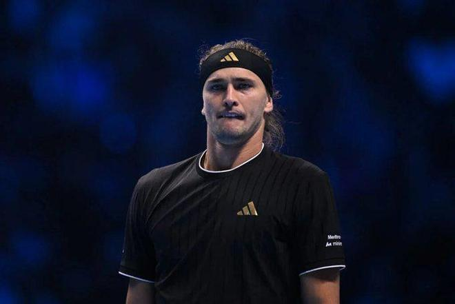

经过了6个比赛日的激战之后，本赛季ATP年终总决赛四强阵容全部出炉。前4号种子兹维列夫、阿尔卡拉斯、谢尔顿和梅德维德夫4人，成功突围小组赛会师总决赛四强。接下来，将会是更加紧张刺激的淘汰赛阶段比赛。

在麦肯罗组的比赛当中，头号种子兹维列夫取得了3战全胜不失一盘的成绩，排名小组第1位成功挺进四强。另一个晋级名额属于3号种子谢尔顿，他在小组赛阶段取得了2胜1负的成绩。1胜2负的菲斯和3战皆负的霍达尔，结束了今年的总决赛征程。

伦德尔组的小组赛比赛当中，阿尔卡拉斯延续了自己在今年室内硬地赛季的强势发挥，3战全胜不失一盘，将自己的连胜场次累加到了12场。另一个晋级名额属于4号种子梅德维德夫，梅总以2胜1负的成绩跻身四强。蒂亚福和科博利两人，在小组赛阶段遭到了淘汰。

接下来的半决赛比赛，头号种子兹维列夫将同4号种子梅德维德夫交手，这将是两位90后代表人物职业生涯第23次碰面，交战记录上梅总14胜8负稍占优势。阿尔卡拉斯将同谢尔顿迎来生涯第6次交手，此前5次碰面阿卡4胜1负，其中就包括了不久前在巴黎大师赛决赛的交手。

ATP年终总决赛单打四强对阵

【1】兹维列夫VS【4】梅德维德夫

【2】阿尔卡拉斯VS【3】谢尔顿

特别声明：以上内容(如有图片或视频亦包括在内)为自媒体平台“网易号”用户上传并发布，本平台仅提供信息存储服务。

Notice: The content above (including the pictures and videos if any) is uploaded and posted by a user of NetEase Hao, which is a social media platform and only provides information storage services.

排球黄金眼 2026-11-20 08:58:27

全网球APP 2026-11-20 12:06:07

全景体育V 2026-11-21 06:10:09

网球之家 2026-11-20 12:46:53

主持人行行 2026-11-18 12:33:29

星河漫山野 2026-11-21 00:41:29

快乐加载中21 2026-11-21 03:31:28

热血体育社 2026-11-20 23:11:01

温柔且自由 2026-11-21 05:34:55

体坛观察猿 2026-11-21 05:44:08

情动则心痛就 2026-11-21 03:41:18

创造精彩剧情 2026-11-21 04:17:44

范瞼舍长 2026-11-21 05:46:30

侧身凌空斩 2026-11-20 22:28:09

网球之家 2026-11-20 22:27:12

鹦鹉梨 2026-11-20 06:06:57

篮坛第一线 2026-11-21 05:41:06

主持人行行 2026-11-20 10:13:26

赛场速报局 2026-11-21 06:14:30

足球印象CC 2026-11-18 07:41:27

咪咕体育 2026-11-19 06:57:19

网球之家 2026-11-20 18:26:22

23号球魁 2026-11-18 20:10:17

大象新闻 2026-11-20 18:35:02

极目新闻 2026-11-20 15:01:38

大风新闻 2026-11-20 20:07:09

玫瑰刺青渗毒液q 2026-11-20 00:25:59

左脚爆射得分 2026-11-19 13:11:39

秋梨电影 2026-11-20 06:05:58

四号花店p 2026-11-20 06:43:41

史之铭 2026-11-21 03:24:28

新民晚报 2026-11-20 18:54:38

浅海 2026-11-20 07:24:07

新京报 2026-11-20 10:12:11

告白手工 2026-11-20 06:14:53

华夏云海 2026-11-20 09:51:03

界面新闻 2026-11-20 15:26:50

潇湘晨报 2026-11-20 12:00:15

极度说球 2026-11-18 15:27:58

闪电新闻 2026-11-20 10:50:52

## 配图

图：网球（网易体育 · 2026-11-21）

## 来源

- [网易体育 · 原文](https://www.163.com/dy/article/LC85R6AU0529TPTB.html)
