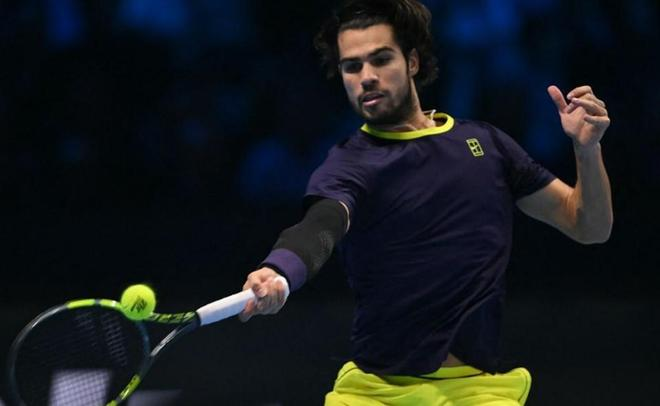

11月22日凌晨，ATP年终总决赛第7比赛日结束争夺。头号种子兹维列夫和2号种子阿尔卡拉斯成功会师，两人将上演今年ATP巡回赛的终极一战。在双打赛场的比赛当中，4号种子阿雷瓦洛/帕维奇和8号种子阿里巴热/奥利维蒂成功会师。

阿尔卡拉斯3-6、6-3、7-6(1)谢尔顿

首盘比赛谢尔顿凭借着第2局的破发，6-3先赢一盘。第二盘阿尔卡拉斯在第7局完成唯一一次破发，6-3将比赛拖入决胜盘。决胜盘双方僵持到抢七才分出胜负，阿尔卡拉斯7-1赢下决胜盘抢七的胜利。

获胜的阿尔卡拉斯将自己的连胜场次累加到了13场，这是他连续2年在年终总决赛跻身决赛，同时也成为了2010年和2013年的纳达尔之后，第2位多次在总决赛闯入决赛的西班牙人。

兹维列夫7-6(0)、6-4梅德维德夫

首盘比赛双方前12局互不相让，兹维列夫在抢七局连下7分，7-0赢下了首盘抢七的胜利。第二盘兹维列夫在第7局完成了整场比赛的唯一一次破发，6-4再胜一盘。

获胜的兹维列夫时隔5年再次在年终总决赛闯入决赛，这是他职业生涯第3次总决赛决赛之旅，此前2次进入决赛的兹维列夫均最终夺冠。

两场双打半决赛的比赛竞争都非常激烈。4号种子阿雷瓦洛/帕维奇7-6(10)、6(7)-7、10-7险胜2号种子哈里森/斯卡普斯基。6号种子阿里巴热/奥利维蒂7-6(4)、6(6)-7、12-10险胜7号种子克拉维茨/皮茨。

特别声明：以上内容(如有图片或视频亦包括在内)为自媒体平台“网易号”用户上传并发布，本平台仅提供信息存储服务。

Notice: The content above (including the pictures and videos if any) is uploaded and posted by a user of NetEase Hao, which is a social media platform and only provides information storage services.

晚风知我意21 2026-11-22 05:01:27

林间小温柔 2026-11-22 03:31:11

侧身凌空斩 2026-11-22 05:13:09

情动则心痛就 2026-11-21 03:41:18

竞技风云录 2026-11-22 01:27:41

网球之家 2026-11-21 23:56:20

主持人行行 2026-11-21 19:02:15

网球之家 2026-11-21 22:02:53

新华社 2026-11-21 17:59:32

懂球帝 2026-11-21 21:46:19

甜份超标的我 2026-11-22 00:57:13

主持人行行 2026-11-22 00:37:51

阿嬍体育评论 2026-11-22 03:53:54

蓝桥春雪k 2026-11-22 04:11:42

主持人行行 2026-11-20 10:13:26

坠入温柔晚风 2026-11-22 04:24:33

懂球帝 2026-11-22 03:51:01

足球印象CC 2026-11-18 07:41:27

咪咕体育 2026-11-19 06:57:19

澎湃新闻 2026-11-21 07:26:18

都市快报橙柿互动 2026-11-21 17:58:25

脑洞编剧小剧场 2026-11-20 01:46:19

极目新闻 2026-11-21 20:11:56

领略非凡 2026-11-22 02:52:36

遵义发布 2026-11-21 06:41:03

迎男而上 2026-11-21 00:50:45

星河漫山野 2026-11-22 01:47:16

球事百科吖 2026-11-22 06:17:15

斯帝卡V乒乓 2026-11-21 10:02:48

新华社 2026-11-21 11:28:03

云天之巅明 2026-11-20 21:37:55

老白者乎 2026-11-22 02:40:03

秋Tian动漫 2026-11-20 06:42:32

吉刻新闻 2026-11-21 13:41:01

老牧说说 2026-11-22 04:48:51

刘姚尧的文字城堡 2026-11-22 06:35:38

咪咕体育 2026-11-21 16:22:42

老涺学科普 2026-11-21 21:13:07

新华社 2026-11-21 20:18:05

蓝鲸新闻 2026-11-19 16:25:03

## 配图

图：网球（网易体育 · 2026-11-22）

## 来源

- [网易体育 · 原文](https://www.163.com/dy/article/LCANVHGR0529TPTB.html)
