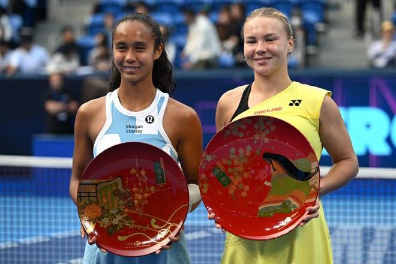

11月1日，WTA东京站、广州站两项赛事落下了帷幕，施耐德苦战三盘2-1险胜费尔南德斯，夺得生涯第六座单打冠军；达特苦战三盘2-1逆转塔格尔，收获生涯首座单打冠军。

东京站500赛：施耐德VS费尔南德斯

原本头号种子莱巴金娜是最有希望夺冠的选手，这位新科世界第一宣布因伤退出，让费尔南德斯轻松晋级，一路打进了决赛，却输给了3号种子施耐德。

这是施耐德生涯第七个单打决赛，是费尔南德斯生涯第11个单打决赛，经过三盘的较量，施耐德以6-4、5-7、6-2击败费尔南德斯，夺得赛季首冠，也是生涯第六冠。值得一提的是，施耐德最近六次打进单打决赛全部取胜，同时连续三年都有500赛冠军入账。

尽管无缘冠军，但费尔南德斯在亚洲赛季也是收获颇丰，短短一个半月内打进了新加坡、宁波、东京三站500赛的决赛，大幅度提升了世界排名。

广州站250赛：塔格尔VS达特

半决赛阶段，4号种子塔格尔直落两盘淘汰克韦多，闯进自己今年第二个、职业生涯第三个单打决赛；从资格赛突围的达特，苦战三盘逆转持外卡参赛的16岁新星孙心然，职业生涯首次闯入WTA级别单打决赛。

双方此前唯一一次交手发生在今年年初一站ITF赛事决赛中，当时塔格尔直落两盘完胜达特。

首盘比赛，达特4-6先输一盘，随后第二盘6-3扳平大比分，到了决胜盘6-4再胜，总比分2比1逆转4号种子塔格尔，从资格赛打起一黑到底，夺得职业生涯第一个WTA级别单打冠军，同时总积分达到854分，世界排名升至第84位，重返TOP100。

随着广州网球公开赛的落幕，WTA最新排名如下：

本周中东京站拿下一场胜利之后，莱巴金娜总积分达到8099分，提前锁定了年终世界第一的排名，奖杯将在FAGE印第安维尔斯WTA年终总决赛上颁发。

今年没有拿到一座大满贯冠军的萨巴伦卡，不仅丢掉世界第一，就连世界第二快要保不住，因为排名第三的米拉-安德烈娃仅仅落后180分。其他世界前十方面，高芙、佩古拉、诺斯科娃、斯瓦泰克四人的位置有所变动。

拿到东京站冠军的施耐德，总积分达到3238分，升至世界第11位，获得东京站亚军的费尔南德斯，总积分达到2201分，升至世界第18位。

尽管提前结束本赛季，但郑钦文的世界排名上升了一位，来到世界第21位，非常接近前20位。

打进广州站四强的孙心然，收获本站赛事98个积分，世界排名升至第302位，飙升了103位。

就在今天下午，孙心然因下肢伤势退出WTA250中国香港站的比赛，此前广州站半决赛对阵达特的比赛，孙心然申请了医疗暂停。

特别声明：以上内容(如有图片或视频亦包括在内)为自媒体平台“网易号”用户上传并发布，本平台仅提供信息存储服务。

Notice: The content above (including the pictures and videos if any) is uploaded and posted by a user of NetEase Hao, which is a social media platform and only provides information storage services.

参考消息 2026-10-31 20:35:09

政知新媒体 2026-11-01 15:18:21

看看新闻Knews 2026-10-31 21:35:15

大风新闻 2026-10-31 22:04:03

江南晚报 2026-11-01 12:18:22

都市快报橙柿互动 2026-11-01 16:07:04

新京报 2026-11-01 11:46:23

扬子晚报 2026-10-31 19:54:41

现代快报 2026-11-01 15:59:11

环球网资讯 2026-11-01 17:25:17

日照日报 2026-10-31 22:02:00

国际在线 2026-10-31 20:57:27

文汇报 2026-11-01 15:11:04

19楼 2026-11-01 19:37:01

江津融媒 2026-11-01 19:35:39

## 配图

图：网球（网易体育 · 2026-11-01）

## 来源

- [网易体育 · 原文](https://www.163.com/dy/article/LAM1BIFI05497GLB.html)
