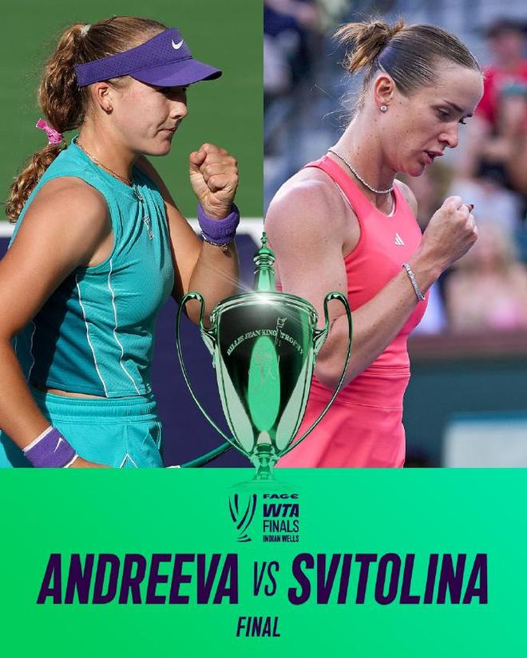

WTA年终总决赛女单决赛，米拉-安德列娃直落两盘，大比分2-0战胜斯维托丽娜，生涯首次参赛情况下拿下冠军，同时收获1500个积分、337万美元（约合人民币2248万元）奖金，成为最大赢家。

今年的年终总决赛，米拉-安德烈娃是状态最出色的选手，小组赛三轮全胜，最终头名昂首晋级四强，随后半决赛2-0淘汰佩古拉。

作为前赛会冠军，斯维托丽娜首轮输给米拉-安德烈娃之后，连胜穆霍娃、萨巴伦卡，小组第二出线，随后半决赛2-0淘汰诺斯科娃，生涯第三次闯入年终决赛。

双方过往三次碰面，米拉-安德烈娃2胜1负占优，包括今年总决赛小组赛阶段击败斯维托丽娜。值得一提的是，无论斯维托丽娜，还是米拉-安德列娃，都在上个月的中网女单比赛输给郑钦文。

现在的决赛，米拉-安德烈娃继续完成压制，第一盘7-5先下一城之后，第二盘6-3再胜，大比分2-0击败斯维托丽娜。

至此，米拉-安德烈娃首次出战年终总决赛便以五战全胜且不失一盘的强势表现捧杯，成功斩获赛季第四冠、职业生涯第七冠。

此外，米拉-安德烈娃从小组赛到决赛的五场比赛，一共只丢了26局比赛，是总决赛历史上丢局数量最少的球员。

2026赛季，米拉-安德烈娃交出耀眼的成绩单，包括大满贯首冠+总决赛首冠、年终排名升至第二、4冠并列巡回赛榜首、55胜领跑全体球员。

随着总决赛的落幕，WTA的年终排名进行了更新：

米拉-安德烈娃夺冠之后，总积分达到7806分，距离排名第一的莱巴金娜不到300分的差距，明年非常有机会冲击世界第一的位置。

此外，萨巴伦卡下降一位，来到第三，由于明年一月份的澳洲赛季保分压力较大，有可能跌出世界前五，高芙、佩古拉、斯维托丽娜、诺斯科娃、穆霍娃、斯瓦泰克、科斯秋克分列第四至第十。

郑钦文拿下中网冠军之后，提前结束本赛季，但世界排名基本没有变化，从第21位到第23位徘徊，现在年终排名也有了定论，就是世界第22位，明年有机会重返世界前十。

特别声明：以上内容(如有图片或视频亦包括在内)为自媒体平台“网易号”用户上传并发布，本平台仅提供信息存储服务。

Notice: The content above (including the pictures and videos if any) is uploaded and posted by a user of NetEase Hao, which is a social media platform and only provides information storage services.

网球之家 2026-11-15 12:17:39

毛豆的家 2026-11-15 00:50:08

奇史怪谈 2026-11-15 09:02:24

一路荒凉如歌a 2026-11-15 15:36:41

全景体育V 2026-11-16 06:08:09

小轲搞笑解说 2026-11-16 00:37:59

网球之家 2026-11-09 18:53:58

侧身凌空斩 2026-11-16 06:01:36

主持人行行 2026-11-15 10:34:24

唐尼二爱生活 2026-11-14 09:01:33

而长终 2026-11-16 04:10:22

精彩一网打尽 2026-11-15 02:45:53

丁铗惊悚影视解说 2026-11-15 21:45:24

文文聊球 2026-11-15 14:07:04

路遇小美好 2026-11-16 00:46:02

Hello吖小志 2026-11-15 09:04:47

奇史怪谈 2026-11-14 08:55:14

莼侃体育 2026-11-15 08:14:15

落雪听梅a 2026-11-15 15:08:54

暮雨清歌u 2026-11-16 01:36:11

新华社 2026-11-14 15:52:27

侧身凌空斩 2026-11-16 05:44:32

绿茵狂热者 2026-11-16 05:18:33

探山城 2026-11-13 10:56:39

安全与法 2026-11-13 15:13:18

A小百合 2026-11-15 01:13:25

澎湃新闻 2026-11-15 18:11:16

南海浪花 2026-11-16 05:48:03

扬子晚报 2026-11-11 07:52:23

微微安x 2026-11-12 05:52:09

星耀球坛 2026-11-14 23:53:13

网球之家 2026-11-15 10:52:22

氧气周末 2026-11-13 12:05:41

星娱STAR 2026-11-15 16:37:50

体坛侃侃球 2026-11-16 00:30:04

春若秋水 2026-11-15 12:37:40

贵圈星娱 2026-11-14 22:58:52

台球Numberone 2026-11-15 06:32:59

央视新闻客户端 2026-11-15 17:26:33

远方的青木 2026-11-13 16:03:03

## 配图

图：网球（网易体育 · 2026-11-16）

## 来源

- [网易体育 · 原文](https://www.163.com/dy/article/LBR9G9TU05497GLB.html)
