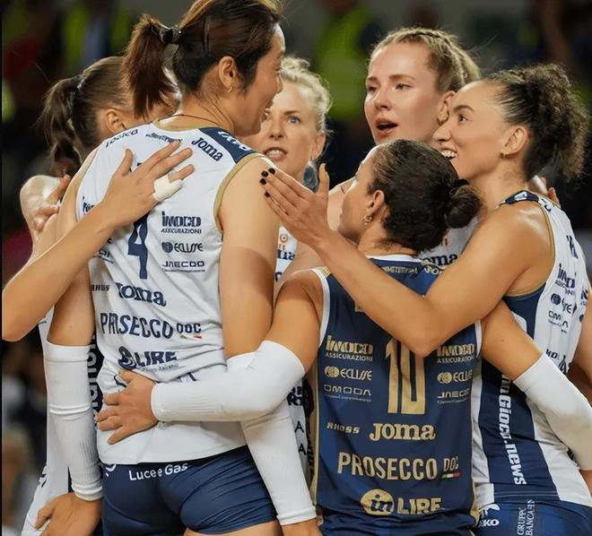

11月7日，意大利媒体《排球新闻》爆出猛料，目前31岁的朱婷很可能在本赛季结束后退役。目前，朱婷效力的意大利科内利亚诺俱乐部已经在物色她的接替人选。

这个月底，朱婷将年满32岁，还远没有到退役的年龄。不过，《排球新闻》称朱婷正在考虑赛季结束后退役，而科内利亚诺已未雨绸缪，欲让俄罗斯主攻托洛克接替朱婷的位置。同时，该媒体表示朱婷也可能去一家离家近的亚洲俱乐部打球。

今年夏天，朱婷与科内利亚诺续约，签订的是一份“1+1”的合同，第二年是球员选项。本赛季，朱婷的状态依旧出色。10月25日，在意甲女排超级杯决赛中，朱婷拿下17分，率队夺冠，这也是朱婷生涯第27个冠军。

10月29日，朱婷在意甲第5轮的比赛中18扣11中3拦1发，拿到全场最高的15分，并被评选为MVP。不难看出，朱婷的实力依旧是顶级的，她完全具备留在意甲打球的资格。若朱婷真的选择退役，那只有一个原因--她自己不想打了。

目前，朱婷方面没有对该传闻做出回应。最近几年，朱婷频繁受到伤病困扰，这在一定程度上影响了她继续打球的动力。此外，朱婷已经远离国家队2年，国内的相关报道严重影响了朱婷的日常生活。

当然，也有网友指出意大利媒体的这个消息爆发于续约谈判期，这背后可能涉及薪资、上场安排和伤病控制等条件的博弈，未必就是最终的决定。

特别声明：以上内容(如有图片或视频亦包括在内)为自媒体平台“网易号”用户上传并发布，本平台仅提供信息存储服务。

Notice: The content above (including the pictures and videos if any) is uploaded and posted by a user of NetEase Hao, which is a social media platform and only provides information storage services.

北京网络举报 2026-11-07 11:39:53

澎湃新闻 2026-11-07 17:15:30

央视新闻客户端 2026-11-07 02:16:11

中国新闻周刊 2026-11-07 10:01:01

最江阴 2026-11-07 10:47:11

洪观新闻 2026-11-04 17:53:31

极目新闻 2026-11-07 15:54:15

证券时报 2026-11-07 15:47:41

参考消息 2026-11-07 17:58:12

封面新闻 2026-11-06 17:10:08

央视新闻客户端 2026-11-07 10:02:59

扬子晚报 2026-11-07 08:59:35

南方都市报 2026-11-06 08:33:38

人民网 2026-11-07 11:02:00

农视网 2026-11-07 18:37:17

农视网 2026-11-07 19:25:25

## 配图

图：排球（网易体育 · 2026-11-07）

## 来源

- [网易体育 · 原文](https://www.163.com/dy/article/LB47G8MG05566VBM.html)
